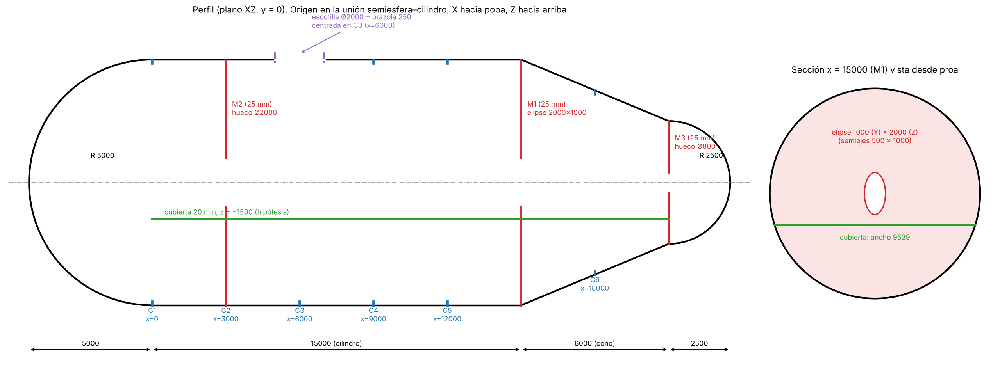

# Tarea MEF: submarino simplificado a 250 m

**Diseño de Estructuras Navales · UPM ETSI Navales · 1º MUINO 2026-27 · entrega antes de las 23:59 del jueves 26-11-2026**

Unidades en todo el documento: **mm, N, MPa (N/mm²), t**, igual que la [guía de Femap](../../guias/femap/guia-visual-femap-2412.md).

Archivos de esta carpeta:

| Archivo | Para qué sirve |
|---|---|
| `README.md` | Interpretación del enunciado, procedimiento en Femap y qué hay que entregar |
| `geometria_submarino.png` | Perfil y sección acotados según la interpretación adoptada |
| `calculos_analiticos.py` | Cálculos de comprobación: tensiones, cambio dimensional y pandeo |
| `resultados_analiticos.txt` | Salida del script anterior |
| `dibujo_geometria.py` | Script que genera la figura |
| `pasos_malla_a_resultados.md` | Pasos desde la malla hasta los resultados, en los ejes del modelo de Femap (vertical = −Y, cubierta en y = +1500, simetría z = 0) |

> Los valores analíticos **no son resultados de Femap**: no se ha ejecutado Femap ni Nastran para preparar esta carpeta. Sirven para comprobar que tu modelo da el orden de magnitud correcto y para comentar los resultados en el informe.

---

## 1. Qué piden

Modelar en Femap (láminas + vigas) un casco resistente simplificado y hacer:

1. **Análisis lineal estático** (Nastran SOL 101): tensiones y desplazamientos.
2. **Cambio dimensional**: variación de eslora, diámetro y volumen bajo presión.
3. **Análisis de inestabilidad**: pandeo lineal por autovalores (Nastran SOL 105).

Carga: presión exterior a 250 m de profundidad.

## 2. Interpretación del enunciado

El enunciado deja varias cosas abiertas. Esta es la interpretación adoptada; **escríbela en el informe** y, si puedes, confírmala con el profesor.

| Punto | Interpretación adoptada | Motivo |
|---|---|---|
| Ejes | Origen en la unión semiesfera–cilindro, **X hacia popa**, Z hacia arriba, Y a babor | Las cotas del cilindro quedan en x = 0…15000 |
| Radios | 5000 y 2500 mm se toman como radios de la **superficie media** | Con láminas se modela la superficie media; el error es t/2R = 0,35 % |
| Cuadernas del cilindro | 5 cuadernas en **x = 0, 3000, 6000, 9000 y 12000** (separación 3000) | «Equiespaciadas, la primera en la unión esfera-cilindro». Con separación 3000, el último vano (12000→15000) lo cierra el mamparo M1. Si las separas 3750, la quinta coincide con M1 |
| Cuaderna del cono | **x = 18000** (mitad del cono, r = 3750) | El enunciado sólo dice «una cuaderna en el tronco de cono» |
| Perfil de cuaderna | T 150×150×15: alma 150×15 y ala 150×15, **por el interior** del casco | Disposición habitual en cascos resistentes |
| Mamparo M1 | x = 15000 (base mayor del cono), plano, 25 mm; hueco elíptico centrado de **semiejes 1000 × 500** (vertical × horizontal), es decir, 2000 × 1000 mm | «r = 1000x500» se lee como radios (semiejes). Vertical como una puerta |
| Mamparo M2 | x = 3000 («una cuaderna por detrás» de la unión: coincide con C2), 25 mm, hueco circular **r = 1000** (Ø2000) | «Radio igual al mayor de antes» |
| Mamparo M3 | x = 21000 (unión cono–semiesfera), r = 2500, 25 mm, hueco **r = 400** | — |
| Cubierta | Plana, 20 mm, a **z = −1500**, desde x = 0 (C1) hasta x = 21000 (M3), cortada por el casco | No se da la altura. A z = 0 cortaría los huecos «centrados» de los mamparos; a −1500 los deja libres. Llega al cono porque el enunciado pide bao en la cuaderna del cono |
| Baos | Bajo la cubierta, en cada cuaderna (x = 0, 3000, 6000, 9000, 12000, 18000), mismo perfil T 150×150×15 | «Baos correspondientes a las cuadernas» |
| Escotilla | Agujero de Ø2000 en la parte alta, **centrado en x = 6000** (C3). C3 queda interrumpida dentro del agujero | «Simétrico proa-popa respecto del plano de la cuaderna» |
| Brazola | Tubo vertical de radio 1000, **35 mm**, extruido **250 mm hacia arriba desde el borde del agujero** en todo su contorno (borde superior también en «silla de montar») | No se da el espesor; se toma el del casco. Al extruir el propio borde del agujero, la brazola queda unida al casco |
| Material | Acero HY80 / HS56: E = 210000 MPa, ν = 0,3, ρ = 7,85e-9 t/mm³, σy ≈ 550 MPa | HY80 = 80 ksi = 552 MPa; 56 kp/mm² = 549 MPa |
| Presión | p = ρ g h = 1,025e-9 · 9810 · 250000 = **2,514 MPa** manométrica, uniforme | La variación entre quilla y techo (0,10 MPa, 4 %) es despreciable para este ejercicio |



Datos geométricos derivados:

| Magnitud | Valor |
|---|---|
| Eslora total | 28500 mm (x = −5000 … 23500) |
| Semiángulo del cono | 22,62° (generatriz 6500 mm) |
| Ancho de la cubierta en el cilindro (z = −1500) | 2·√(5000² − 1500²) = 9539 mm |
| Ancho de la cubierta en M3 (r = 2500) | 2·√(2500² − 1500²) = 4000 mm |
| Volumen encerrado | 1747,5 m³ |

## 3. Construcción del modelo en Femap

Las rutas de menú marcadas como **confirmadas** están contrastadas en la guía de Femap con las capturas de clase. Las demás son orientativas: comprueba el nombre exacto en tu versión.

### 3.1 Material y propiedades

`Model → Material…` (confirmada): `HY80`, isótropo, E = 210000, ν = 0,3, densidad 7,85e-9.

`Model → Property…` (confirmada):

| ID | Nombre | Tipo | Espesor / sección |
|---|---|---|---|
| 1 | Casco | Plate | 35 |
| 2 | Mamparos | Plate | 25 |
| 3 | Cubierta | Plate | 20 |
| 4 | Brazola | Plate | 35 |
| 5 | Cuadernas_T | Beam, forma T de la librería de secciones | alma 150 × 15, ala 150 × 15 |
| 6 | Baos_T | Beam, igual que 5 | — |

Separar las propiedades sirve después para filtrar resultados por grupo (casco, mamparos, cubierta…).

### 3.2 Casco por revolución

Crea los puntos de la generatriz en el plano XZ (y = 0) y revoluciónala 360° alrededor del eje X (Base `(0,0,0)`, Tip `(1,0,0)`):

| Tramo | Curva |
|---|---|
| Semiesfera de proa | Arco de centro (0,0,0), de (−5000,0,0) a (0,0,5000) |
| Cilindro | Rectas (0,0,5000)→(3000,0,5000)→(6000…)→…→(15000,0,5000), **una recta por vano** |
| Cono | Rectas (15000,0,5000)→(18000,0,3750)→(21000,0,2500) |
| Semiesfera de popa | Arco de centro (21000,0,0), de (21000,0,2500) a (23500,0,0) |

Partir la generatriz en las posiciones de cuadernas y mamparos hace que la revolución produzca superficies separadas cuyos bordes circulares son exactamente las líneas donde van las cuadernas y los mamparos. Así los nodos quedan compartidos.

`Geometry → Surface → Revolve…` (confirmada). Para que la escotilla y la cubierta queden bien conectadas, conviene revolucionar en **cuatro tramos de 90°** (o partir después las superficies por los planos y = 0 y z = −1500).

### 3.3 Mamparos

Superficies planas circulares en x = 3000 (R 5000), x = 15000 (R 5000) y x = 21000 (R 2500), recortadas por su hueco:

- M1: elipse centrada en (15000, 0, 0), semieje vertical 1000 y horizontal 500.
- M2: circunferencia de radio 1000 centrada en (3000, 0, 0).
- M3: circunferencia de radio 400 centrada en (21000, 0, 0).

Divide además cada mamparo por la recta z = −1500 donde lo cruza la cubierta.

### 3.4 Cubierta

Plano z = −1500 de x = 0 a x = 21000. En el cilindro sus bordes son las rectas y = ±4769,7; en el cono el borde es curvo (intersección plano–cono). Lo más cómodo es crear un rectángulo grande y recortarlo/partirlo con el casco. Pártela también en x = 3000, 6000, 9000, 12000, 15000 y 18000.

### 3.5 Escotilla y brazola

1. Crea un cilindro vertical auxiliar de radio 1000, eje paralelo a Z por (6000, 0), desde z = 4500 hasta z = 5250.
2. Interséctalo con el casco (`Geometry → Curve - From Surface → Intersect…`): la curva de intersección es la «silla de montar» por la que se corta el agujero.
3. Elimina el trozo de casco interior al agujero y el cilindro auxiliar.
4. Extruye el borde del agujero 250 mm en +Z (`Geometry → Surface → Extrude…`, vector (0,0,0)→(0,0,250)): esa superficie es la brazola, de 250 mm de altura en todo su contorno y unida al casco por la misma curva.

### 3.6 Conectar todo

Todas las superficies deben compartir bordes donde se tocan: casco–mamparos, casco–cubierta, mamparos–cubierta y casco–brazola. En Femap la herramienta habitual es unir las superficies en un cuerpo **non-manifold** (`Geometry → Solid → Non-Manifold Add…`, ruta pendiente de confirmar en tu versión) antes de mallar. Después de mallar, comprueba **bordes libres**: sólo deben aparecer en los bordes de los huecos de los mamparos, el borde superior de la brazola y los extremos de la cubierta en x = 0. Si aparecen en una unión, esa unión no está conectada.

### 3.7 Cuadernas y baos como vigas

- Cuadernas: elementos Beam sobre las curvas circulares del casco en x = 0, 3000, 6000, 9000, 12000 y 18000. En C3 se interrumpen en la escotilla (de y = −1000 a y = +1000 por la parte alta).
- Baos: elementos Beam sobre las rectas de la cubierta en esas mismas x.
- **Orientación**: el alma debe ir hacia el eje del casco en las cuadernas y hacia abajo en los baos. Usa el vector de orientación y comprueba con `View Options` en modo de sección renderizada.
- **Offset**: la sección se cuelga de la cara interior. Desde la superficie media, el offset hasta el centroide de la T es t/2 + distancia del centroide de la T al pie del alma = 17,5 + 116,3 ≈ 134 mm, hacia dentro. Sin offset las cuadernas quedan centradas en la chapa y su inercia útil es mucho menor.
- En C2 coinciden la cuaderna y el mamparo M2: mantén las dos.

Alternativa: modelar el alma con láminas de 15 mm y el ala con vigas o láminas. Es más fiel para pandeo local de la cuaderna, pero multiplica el trabajo.

### 3.8 Malla

Tamaño de elemento: **200 mm** en general, **100 mm** alrededor de la escotilla, en la unión cilindro–cono y en los bordes de los huecos de mamparos. Elementos Quad4 (admite triángulos en los huecos y en los polos de las semiesferas).

Justificación: el pandeo entre cuadernas da n ≈ 11 lóbulos. Media onda circunferencial: π·5000/11 ≈ 1430 mm, unos 7 elementos de 200 mm. En dirección axial es una media onda de 3000 mm, unos 15 elementos.

Las vigas de las cuadernas y los baos se mallan con el **mismo tamaño** que las curvas del casco y la cubierta para que compartan nodos. Tras mallar: `Merge coincident nodes` con tolerancia pequeña (≈1 mm), comprobación de bordes libres y de normales de las láminas (todas hacia fuera en el casco).

Si la versión Student no deja tanto modelo, pasa a **medio modelo** con simetría y = 0 (véase 4.2).

## 4. Cargas y condiciones de contorno

### 4.1 Cargas (`Model → Load → On Surface…`, confirmada)

| Carga | Dónde | Valor |
|---|---|---|
| Presión | Todo el casco (cara exterior) | 2,514 MPa, **hacia dentro** |
| Presión | Cara exterior de la brazola | 2,514 MPa, hacia su eje |
| Carga de borde (tapa de escotilla cerrada) | Borde superior de la brazola, `On Curve…` | p·π·r²/(2πr) = p·r/2 = **1257 N/mm**, dirección −Z |

Mamparos y cubierta son interiores: no llevan presión.

Comprueba en las flechas que la presión apunta hacia el interior; si apunta hacia fuera, cambia el signo o invierte normales.

La carga de borde de la brazola representa la tapa cerrada. Sin ella, el agujero quita al casco un círculo de presión. Entonces queda una resultante neta hacia arriba de p·π·1000² ≈ **7,9 MN** que acabarían absorbiendo los apoyos, y el resultado no tiene sentido físico.

### 4.2 Apoyos (isostáticos)

El casco está en equilibrio bajo la presión exterior, así que los apoyos sólo deben quitar los 6 movimientos de sólido rígido **sin introducir esfuerzos**:

| Nodo | Situación | Restricciones |
|---|---|---|
| A | Polo de proa (−5000, 0, 0) | TX, TY, TZ |
| B | Polo de popa (23500, 0, 0) | TY, TZ |
| C | Costado en C4 (9000, 5000, 0) | TZ (giro alrededor de X) |

**Comprobación obligatoria:** las reacciones (SPC forces) deben ser prácticamente cero, del orden de los errores de redondeo frente a fuerzas de MN. Si salen grandes, la carga no está equilibrada: falta la carga de la brazola, hay presiones con signo cambiado o falta alguna superficie.

**Medio modelo:** en el plano y = 0 aplica TY, RX y RZ a todos los nodos. Añade TX en A y TZ en A y B. En el pandeo, el medio modelo sólo encuentra los modos simétricos respecto a y = 0. Dilo en el informe o haz también el caso antisimétrico (TX, TZ y RY en el plano).

## 5. Análisis 1: estático lineal (SOL 101)

`Model → Analysis…` (confirmada) → NX Nastran, **Linear Static**. Pide desplazamientos, SPC forces, tensiones y fuerzas de lámina y de viga.

Qué mirar y qué esperar (valores analíticos de membrana, en compresión):

| Zona | Referencia analítica | Qué esperar del MEF |
|---|---|---|
| Cilindro, centro de vano | σθ = pR/t = **359 MPa**, σx = pR/2t = **180 MPa**, von Mises **311 MPa** | Parecido o algo menor en el centro del vano. En las cuadernas σθ baja, pero aparece flexión longitudinal |
| Semiesfera proa | pR/2t = **180 MPa** | Uniforme lejos de la unión |
| Semiesfera popa | **90 MPa** | — |
| Cono, base mayor | σθ = pr/(t cos α) = **389 MPa**, von Mises **337 MPa** | Máximo de membrana del modelo |
| Unión cilindro–cono (x = 15000) | Empuje radial de la membrana del cono ≈ 2600 N/mm | **Flexión local fuerte**: mira Top y Bottom por separado, no sólo el promedio. M1 ayuda a soportarla |
| Escotilla | Concentración de tensiones en el borde del agujero | Pico local. La brazola lo reduce. Es el sitio donde es más probable superar σy |
| Cuadernas | ≈ 340 MPa de compresión circunferencial | La T es muy ligera (4500 mm² frente a 105000 mm² de chapa por vano) |

Criterio: compara la **tensión de von Mises máxima, Top y Bottom,** con σy ≈ 550 MPa. Separa los picos de borde de agujero y unión, que son locales, de la tensión general del casco. Los extremos de los resultados se buscan como explica el apartado 10 de la guía de Femap.

## 6. Cambio dimensional

Crea un sistema de coordenadas **cilíndrico con su eje Z a lo largo del X global** para leer el desplazamiento radial. En Femap el eje de un sistema cilíndrico es su Z local. Después lee:

| Magnitud | Cómo obtenerla del MEF | Referencia analítica (membrana, sin rigidizar) |
|---|---|---|
| Δ eslora | UX(polo de popa) − UX(polo de proa) | ≈ **−8 mm** |
| Δ diámetro del cilindro | 2 × desplazamiento radial en el centro de vano y en las cuadernas | ≈ **−14,5 mm** (w = 7,3 mm hacia dentro) |
| Δ radio semiesferas | Desplazamiento radial | 3,0 mm (proa), 0,75 mm (popa) |
| Δ volumen | Σ (2π r w̄ Δx) por tramos, con el w̄ medio de cada tramo, o a partir de los nodos exportados | ≈ **−5,0 m³ (−0,29 %)**, es decir, unas **5 t de empuje perdido** |

El MEF debe dar algo menos que la referencia: cuadernas y mamparos rigidizan. La deformada típica es en «acordeón»: el casco se hunde más en el centro de cada vano que en las cuadernas, y casi nada en los mamparos. Muestra la deformada amplificada en el informe. La pérdida de empuje por la compresión del casco es la razón práctica de este apartado: el submarino se vuelve más pesado al bajar.

## 7. Análisis 2: inestabilidad (SOL 105)

`Model → Analysis…` → **Buckling**. Usa el mismo conjunto de cargas y apoyos. Pide **20 autovalores** como mínimo (método Lanczos).

- El autovalor λ multiplica la carga aplicada: **p_cr = λ · 2,514 MPa** y **profundidad crítica ≈ λ · 250 m**.
- λ < 1 significa que la estructura pandea **antes** de llegar a 250 m.
- Los λ negativos corresponden a carga invertida (presión interior); no son físicos para este caso.
- El análisis es lineal y sin imperfecciones, así que sobrestima la carga real. En diseño se aplican factores de reducción.

Qué esperar (orden de magnitud analítico):

| Modo | Referencia | λ aproximado |
|---|---|---|
| **Mamparos planos sin refuerzos** (M1, M2), comprimidos en su plano por el casco | Placa circular de 25 mm y R 5000 bajo ≈ 1230 N/mm de borde | **0,04 – 0,14** |
| Cubierta (20 mm, paneles de 3000 entre baos) | Placa comprimida, σcr ≈ 34 MPa | Probablemente < 1 |
| Cono sin cuaderna o entre C6 y M1/M3 | Cilindro equivalente | 0,35 – 0,73 |
| **Inestabilidad general** (casco + cuadernas entre M2 y M1) | Bryant, n = 5 | **≈ 0,54** |
| **Pandeo entre cuadernas** del cilindro (lóbulos) | von Mises, L = 3000, n = 11 | **≈ 0,58** (unos 145 m) |
| Semiesfera proa | Clásica 12,5 MPa (≈3,7 MPa con factor 0,3) | ≈ 5 (≈1,5 con imperfecciones) |
| Semiesfera popa | Clásica 50 MPa | ≈ 20 |

**Interpretación previsible:**

1. Los primeros modos serán casi seguro **locales de los mamparos planos**, y quizá de la cubierta. Una chapa plana de 10 m de diámetro y 25 mm sin refuerzos no aguanta la compresión que le transmite el casco. Hay que mostrarlos y explicarlos, no ocultarlos. Para ver los modos del casco, pide suficientes autovalores (20–50) y recórrelos hasta encontrar los lóbulos del cilindro y el modo general.
2. Con una separación de cuadernas de 3000 mm y una T 150×150×15, **el casco no resiste 250 m**: los modos del casco salen con λ ≈ 0,5–0,6. Las tensiones de pandeo, unos 210 MPa, quedan por debajo de σy, así que el pandeo es elástico. Es la conclusión principal del ejercicio: el casco resiste las tensiones (von Mises 311 < 550 MPa), pero **falla por inestabilidad**.
3. Para la discusión, la sensibilidad a la separación de cuadernas (pandeo entre cuadernas, von Mises) es:

| Separación s (mm) | 3000 | 2500 | 2000 | 1500 | 1000 | 750 |
|---|---|---|---|---|---|---|
| p_cr (MPa) | 1,46 | 1,78 | 2,29 | 3,22 | 5,34 | 7,94 |
| λ | 0,58 | 0,71 | 0,91 | 1,28 | 2,13 | 3,16 |

Habría además que reforzar los mamparos con rigidizadores y aumentar las cuadernas para el modo general.

## 8. Comprobaciones antes de redactar

- [ ] Reacciones ≈ 0 (equilibrio de la presión).
- [ ] Sin bordes libres en uniones; normales del casco coherentes.
- [ ] σθ en el centro de un vano de cilindro, lejos de escotilla y mamparos, cercana a 359 MPa.
- [ ] σ en la semiesfera de proa cercana a 180 MPa.
- [ ] Δ diámetro menor que 14,5 mm y del mismo orden.
- [ ] Modos de pandeo identificados por tipo (mamparo / cubierta / lóbulos / general / cono).
- [ ] Prueba de malla: repite con un tamaño de 150 mm o 100 mm y comprueba que λ del primer modo de casco y σ máxima apenas cambian.

## 9. Guion de informe sugerido

1. Enunciado e **hipótesis de interpretación** (tabla del apartado 2 y figura).
2. Modelo: geometría, materiales, propiedades, tipos de elemento, malla (número de nodos y elementos, tamaño), cargas y apoyos con su justificación.
3. Análisis lineal: deformada, contornos de von Mises Top/Bottom (casco, mamparos, cubierta), tensiones en cuadernas y baos, puntos críticos, comparación con la tabla analítica.
4. Cambio dimensional: Δ eslora, Δ diámetro (vano y cuaderna), Δ volumen y pérdida de empuje.
5. Inestabilidad: tabla de los primeros λ con descripción y figura de cada modo, profundidad crítica y comparación con las fórmulas.
6. Conclusiones: el casco aguanta en tensiones pero no en pandeo. Propuesta de mejora: cuadernas más próximas, mamparos rigidizados.

## 10. Recalcular las referencias

```bash
cd ejercicios/submarino-mef-2026
python3 calculos_analiticos.py      # reescribe resultados_analiticos.txt
python3 dibujo_geometria.py         # requiere matplotlib
```

Si cambias una hipótesis (altura de cubierta, separación de cuadernas, E…), edita los datos al principio de `calculos_analiticos.py`.
