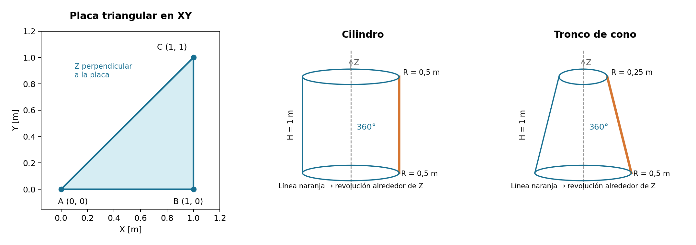

# Guía práctica de Femap: placas, cilindros y conos

**Diseño de Estructuras Navales · Guía para seguir la clase y practicar**

Edición: 23 de octubre de 2026.

Esta guía recorre el proceso completo: geometría → material → espesor → malla → apoyos → cargas → análisis → resultados → comprobaciones. Parte de una placa triangular como la de la imagen de clase y amplía el método a placas rectangulares y láminas cilíndricas y cónicas.

**Configuración solicitada:** Femap Student y sistema internacional coherente: metros (m), newtons (N), pascales (Pa), kilogramos (kg) y segundos (s). Se supone Simcenter/NX Nastran y análisis estático lineal; el número de versión y el solver instalado en clase no están confirmados. Los nombres de comandos se indican en inglés; su ubicación y opciones pueden variar. Las rutas son orientativas: si una no coincide, busca el nombre de la operación en la ayuda instalada de Femap. No confundir Femap, que prepara y muestra el modelo, con el solver, que resuelve las ecuaciones.

**Alcance de la comprobación:** los ejemplos numéricos se han contrastado con sus fórmulas analíticas. Esta guía no se ha ejecutado en una instalación de Femap/Nastran; no presenta simulaciones realizadas ni valores calculados por ese programa. Las cifras de los ejemplos son referencias para comprobar tu propio modelo.

## Índice

1. [Orientarse y entender el modelo](#orientarse)
2. [Unidades, material y propiedad](#material)
3. [Crear placas planas](#placas)
4. [Crear cilindros y conos](#revolucion)
5. [Crear, mejorar y modificar el mallado](#mallado)
6. [Apoyos y restricciones](#apoyos)
7. [Cargas y combinaciones](#cargas)
8. [Resolver y diagnosticar](#analisis)
9. [Ver desplazamientos, tensiones y esfuerzos máximos](#resultados)
10. [Ejercicios con valores de referencia](#ejercicios)
11. [Aplicación a la placa de la fotografía](#fotografia)
12. [Problemas frecuentes y lista de comprobación](#problemas)
13. [Ayuda y referencias](#referencias)

## 1. Orientarse y entender el modelo

### Femap Student: antes de modelar

Consulta **Help → About** y la información de licencia/instalación para identificar la versión y el solver disponible. La edición Student puede limitar el número de nodos y elementos y las soluciones disponibles; el límite concreto depende de la edición instalada y no se presupone aquí. Antes de refinar, consulta el recuento del modelo y compáralo con ese límite. Reducir a la mitad el tamaño de una malla de superficie aumenta aproximadamente cuatro veces su número de elementos. Los ejemplos comienzan con mallas moderadas; evita refinamientos globales innecesarios.

La licencia debe permitir ejecutar el solver elegido. Guarda en el formato nativo compatible con la instalación de clase; una versión más nueva puede no ser intercambiable directamente con una antigua.

### 1.1. Qué es cada cosa

| Entidad | Qué representa | Ejemplo |
|---|---|---|
| Point / Curve / Surface | Geometría que sirve para construir el modelo | Contorno y superficie media de una chapa |
| Node | Punto de cálculo con grados de libertad | Desplazamiento y giro en un vértice de un elemento |
| Element | Pieza matemática que une nodos | Cuadrilátero de lámina |
| Material | Comportamiento del material | Acero: módulo de Young y Poisson |
| Property | Tipo de sección y parámetros geométricos del elemento | Espesor de chapa de 0,01 m |
| Constraint Set | Conjunto de restricciones | Caso de apoyos de una placa |
| Load Set | Conjunto de cargas | Presión, peso propio o tracción |
| Analysis Set / Subcase | Qué cálculo ejecutar y qué conjuntos utiliza | Estática con apoyos A y cargas P |
| Output Set / Vector | Caso calculado y magnitud que se visualiza | Desplazamiento Z del caso de presión |

**Dibujar una superficie no crea elementos. Crear un material no lo asigna a la malla. Dibujar una flecha de carga no garantiza que el caso de análisis la utilice.** Hay que completar cada enlace.

En Femap, una placa o lámina suele usar una propiedad **Plate/Shell**, traducida normalmente a `PSHELL` en Nastran, con elementos `CQUAD4` y/o `CTRIA3`. Estos elementos representan tanto comportamiento de membrana como flexión. Una superficie plana también puede utilizar elementos shell; no necesita ser curva.

Para una chapa delgada, modela su **superficie media** y asigna el espesor mediante la propiedad. Una chapa de 0,01 m no necesita ser un sólido de 0,01 m mallado con tetraedros para estudiar su flexión global. Los sólidos son apropiados cuando necesitas resolver efectos tridimensionales locales, contacto o tensiones a través del espesor que una lámina no representa bien.

### 1.2. Antes de empezar a pulsar botones

1. Guarda el modelo con un nombre claro, por ejemplo `placa_triangular_v01.modfem`.
2. Anota las unidades y dimensiones en una nota del modelo.
3. Identifica el plano de la placa y la dirección normal. En los ejemplos planos será XY, con Z perpendicular.
4. En el árbol del modelo localiza Materials, Properties, Loads, Constraints y Analysis.
5. Practica el filtro de selección: **Curve**, **Surface**, **Node** y **Element** son entidades diferentes. Si no puedes seleccionar algo, revisa primero el filtro.
6. Para cambiar una entidad existente, selecciónala en el árbol y usa su edición; crear otra del mismo nombre no sustituye necesariamente a la anterior.

### 1.3. Tres sistemas de ejes que no debes confundir

- **Global:** describe la posición del modelo completo.
- **Nodal de desplazamientos/restricciones:** define qué significan los componentes de movimiento y de apoyo de un nodo. En Nastran está relacionado con el campo `CD` del nodo `GRID`.
- **Local del elemento/material:** define las direcciones de muchos resultados de placa, orientaciones y caras superior/inferior.

Activar un sistema para introducir coordenadas **no garantiza** que hayas cambiado el sistema de restricciones de los nodos ni los ejes de resultados.

## 2. Unidades, material y propiedad

### 2.1. Un sistema coherente

Femap/Nastran necesita datos coherentes: escribir «SI» en el nombre del modelo no convierte automáticamente todos los valores.

| Magnitud | Unidad utilizada | Ejemplo para acero |
|---|---|---:|
| Longitud y espesor | m | Espesor 0.01 m = 10 mm |
| Fuerza | N | 1000 N |
| Tensión, presión y Young | Pa = N/m² | E = 2.10e11 Pa |
| Momento total | N·m | 100 N·m |
| Masa | kg | — |
| Densidad | kg/m³ | 7850 kg/m³ |
| Tiempo | s | — |
| Aceleración | m/s² | Gravedad 9.81 m/s² |

En las casillas del programa suele utilizarse punto decimal: `0.3`, `0.01`, `2.10e11`. Los valores son ejemplos habituales de acero, no una especificación de material naval concreto. **Si dibujas una placa de un metro, introduce `1`, no `1000`; si tiene 10 mm de espesor, introduce `0.01`.** Para Young, introduce `2.10e11`, no `210000`: este último valor corresponde a MPa en otro sistema.

Conversión útil al leer el enunciado: 1 mm = 0.001 m; 1 MPa = 1e6 Pa; 1 kN = 1000 N. Una tensión calculada de 10000000 Pa se puede presentar como 10 MPa, indicando la conversión. Con densidad de masa coherente, no apliques además una conversión de peso a masa; revisa `WTMASS` si la plantilla del profesor lo utiliza.

### 2.2. Crear un material

1. Abre **Model → Material** y crea uno nuevo.
2. Ponle un nombre que incluya las unidades, por ejemplo `Acero_E2.10e11_Pa_SI`.
3. Elige comportamiento **Isotropic** para los ejemplos.
4. Introduce `E = 2.10e11`, `Nu = 0.3`, `Mass Density = 7850`.
5. Si el formulario calcula el módulo de cortadura, comprueba que sea coherente con $G=E/[2(1+\nu)]$, aproximadamente `8.076923e10 Pa`.
6. Para dilatación térmica, añade el coeficiente de expansión apropiado; como ejemplo de acero, `1.2e-5 /°C`. Define también la temperatura de referencia en el lugar que corresponda al modelo térmico/material.

La densidad importa para peso propio, inercias y modos. El límite elástico sirve para evaluar o definir plasticidad, pero **no convierte un análisis lineal en elastoplástico** por introducirlo en una casilla.

### 2.3. Crear y asignar una propiedad

1. Abre **Model → Property**.
2. Elige el tipo **Plate/Shell**, no una propiedad únicamente de membrana si quieres estudiar flexión.
3. Asigna el material creado y `Thickness = 0.01` m.
4. Usa inicialmente superficie media y offset nulo. Un offset representa una excentricidad real y puede cambiar el acoplamiento y los momentos.
5. Cuando malles, selecciona esta propiedad.
6. Inspecciona después un elemento: debe tener el ID de propiedad correcto y ésta el material correcto.

Para varios espesores, crea propiedades diferenciadas y asígnalas a zonas. Para cambiar el espesor de toda una zona **no necesitas remallar** si la geometría media no cambia: edita la propiedad, vuelve a resolver y no confundas los resultados anteriores con los nuevos.

## 3. Crear placas planas

### 3.1. Placa triangular similar a la fotografía

Usaremos un ejemplo con dimensiones inventadas para practicar; **no se han deducido dimensiones de la foto**:

- A = `(0, 0, 0)` m.
- B = `(1, 0, 0)` m.
- C = `(1, 1, 0)` m.

1. Crea los tres puntos con **Geometry → Point**.
2. Crea segmentos A–B, B–C y C–A con **Geometry → Curve → Line**, seleccionando extremos o introduciendo coordenadas.
3. Crea una superficie plana cerrada seleccionando esas tres curvas. Busca **Geometry → Surface → Edge Curves** o la operación de superficie delimitada por curvas de tu versión.
4. Comprueba que se seleccione una **superficie**, no sólo las tres líneas.
5. Muestra sus bordes y comprueba que no queden huecos entre extremos.

Si falla la superficie: busca curvas duplicadas, puntos casi coincidentes o puntos con Z diferente. No cierres un hueco grande con una tolerancia excesiva; corrige su geometría.

### 3.2. Rectángulos, agujeros y varias zonas

Para un rectángulo puedes usar una superficie por esquinas o construir cuatro curvas y cerrar el contorno. Para un agujero, crea su círculo en el mismo plano y utiliza la operación de recorte de superficie (**Trim**); una circunferencia dibujada encima no elimina material por sí sola.

Divide una superficie cuando necesites representar un cambio de espesor, un borde de apoyo interior, un refuerzo o una zona cargada. Usa las operaciones de división/recorte de superficies de tu versión. Después verifica que las superficies vecinas compartan un borde geométrico o una conexión de malla compatible.

Un refuerzo de viga debe estar realmente conectado a los nodos de la chapa; que una línea pase visualmente por encima no establece la unión. También hay que representar su excentricidad si ésta es relevante.

## 4. Crear cilindros y conos como superficies

### 4.1. La idea que sirve para ambos

Una **generatriz** es una línea que gira alrededor de un eje. Paralela al eje produce un cilindro; inclinada produce un cono o tronco de cono.

Usaremos el eje global Z, definido por los puntos `(0,0,0)` y `(0,0,1)`. Los radios se miden desde ese eje, no son diámetros.

### 4.2. Cilindro de radio 0,5 m y longitud 1 m

1. Crea P1 = `(0.5,0,0)` y P2 = `(0.5,0,1)`.
2. Crea una curva recta P1–P2.
3. Busca **Geometry → Surface → Revolve** —superficie por revolución— y selecciona esa curva.
4. Define el eje Z con los dos puntos del eje y un ángulo de `360°`.
5. Comprueba que obtienes la **superficie lateral**, abierta en los extremos, de radio 0,5 m y longitud 1 m.
6. Si tu versión prefiere trabajar por sectores, crea cuatro sectores de `90°`. Antes de mallar, establece bordes compartidos; después comprueba conectividad en las uniones.
7. Asigna una propiedad shell, por ejemplo de espesor `0.005 m`.

Alternativa: crear una circunferencia de radio 0,5 m en XY y extruirla a lo largo de Z como **superficie**. Extruir una región rellena o crear un sólido cilíndrico no es la misma operación.

Aquí el radio 0,5 m es el de la superficie media. Si te dan el diámetro exterior, el radio medio de un cilindro es $R_m=D_{ext}/2-t/2$.

### 4.3. Tronco de cono

Ejemplo: radio inferior `0.5 m`, radio superior `0.25 m`, altura `1 m`.

1. Crea P1 = `(0.5,0,0)` y P2 = `(0.25,0,1)`.
2. Crea la línea inclinada P1–P2.
3. Revoluciona esa línea `360°` alrededor de Z, igual que en el cilindro.
4. Comprueba radios y altura.
5. Aplica una propiedad shell con el espesor medido **normalmente a la pared**.

No obtengas el radio medio de un cono restando automáticamente `t/2` al radio exterior: la separación entre superficies se mide en dirección normal a la generatriz y depende del ángulo. Para empezar, usa dimensiones de la superficie media explícitamente indicadas.

### 4.4. Cono completo y tapas

Para un cono completo, el extremo superior de la generatriz llega al eje: P2 = `(0,0,H)`. Allí todos los meridianos convergen. La punta puede producir elementos muy pequeños y mal condicionados; usa una malla apropiada con triángulos alrededor de un vértice compartido. Si el ejercicio permite un pequeño truncamiento físico, resulta más sencillo empezar por un tronco de cono. No modifiques una punta real sólo para ocultar un máximo de tensión.

Una revolución de una línea crea una pared, **no las tapas**. Si necesitas tapas, créalas y conéctalas a la pared. En un recipiente cerrado, la presión sobre las tapas transmite fuerza axial a la pared; omitir tapas y su efecto cambia el problema.

### 4.5. Qué comprobar en una superficie cerrada

- La costura de 0°/360° debe tener conexión mecánica, no dos filas independientes de nodos coincidentes.
- Comprueba bordes libres: la costura de un cilindro cerrado lateralmente no debe comportarse como una grieta.
- Muestra las normales de los elementos: deben ser consistentes. Importan para el sentido de la presión, las caras superior/inferior y los signos de resultados.
- Para comparar esfuerzos circunferenciales y longitudinales, define una orientación local coherente. No supongas que el X local de cada elemento coincide siempre con la misma dirección física.

## 5. Crear, mejorar y modificar el mallado

### 5.1. Primera malla de una placa

1. Crea previamente material y propiedad.
2. En **Mesh → Mesh Control → Size On Surface**, fija un tamaño inicial. Para la placa triangular de 1 m, prueba `0.1 m`.
3. En **Size On Curve**, ajusta bordes que necesiten un número específico de divisiones.
4. Usa **Mesh → Geometry → Surface** para mallar la superficie.
5. Selecciona la propiedad Plate/Shell adecuada.
6. Como primera aproximación, usa una malla principalmente de cuadriláteros; permite triángulos donde la geometría lo requiera.
7. Inspecciona IDs de propiedad, conectividad, normales y calidad antes de cargar y resolver.

El tamaño de malla es una dimensión aproximada en el plano de la chapa, **no su espesor**. En un modelo shell no necesitas varias capas de elementos a través del espesor.

### 5.2. Malla libre, mapeada y elección de elementos

| Opción | Cuándo ayuda | Qué vigilar |
|---|---|---|
| Malla libre | Contornos irregulares, agujeros, triángulos | Distorsión y transiciones bruscas |
| Malla mapeada | Superficies de cuatro lados organizables | Divisiones compatibles en lados opuestos |
| Cuadriláteros lineales | Buen punto de partida para flexión de chapas | Cuadriláteros muy deformados pueden rendir mal |
| Triángulos lineales | Cerrar regiones difíciles y puntas | Su precisión en flexión depende de la formulación; pueden exigir más refinamiento |
| Elementos de orden superior | Más precisión en ciertos problemas suaves/curvos | Compatibilidad del solver, calidad y comparación de convergencia |

No fuerces cuadriláteros muy torcidos para evitar cualquier triángulo. La calidad y convergencia importan más que el aspecto de cuadrícula perfecta.

En la placa triangular puedes dividir el dominio en zonas de cuatro lados para facilitar un mallado estructurado. Otra opción válida es una malla libre de buena calidad con refinamiento gradual. Una malla triangular no es incorrecta por ser triangular, ni una malla de cuadriláteros es correcta por tener cuatro lados.

### 5.3. Cómo modificar una malla existente sin perder el control

**Para hacerla más fina o más gruesa:**

1. Guarda una copia del modelo y anota carga total, apoyos y propiedad.
2. Cambia el tamaño de superficie/curvas.
3. Utiliza la opción de remallado o sustitución de malla asociada, si tu versión la ofrece. Si debes borrar, elimina sólo los elementos de la zona y después los nodos realmente huérfanos. Conserva la geometría y no elimines nodos compartidos por otros elementos.
4. Vuelve a mallar y revisa la conectividad con zonas vecinas.
5. Revisa o vuelve a generar las cargas y restricciones asociadas a geometría. Las aplicadas directamente a nodos/elementos antiguos pueden perderse o quedar incompletas.
6. Comprueba la carga total y las entidades que reciben cada apoyo antes de resolver de nuevo.

**Para refinar sólo una zona:** reduce el tamaño en curvas cercanas, divide la superficie o utiliza controles locales de la herramienta de mallado. Haz una transición gradual hacia la zona gruesa. No subdividas elementos aislados creando nodos colgantes sin una conexión compatible.

**Para mover nodos o suavizar:** usa las herramientas de suavizado/edición de malla de tu versión y conserva su proyección sobre la superficie, los contornos y las uniones. Mover un nodo fuera de la superficie media cambia el modelo, no sólo la estética.

### 5.4. Calidad de elementos

Busca **Tools → Check → Element Quality** o el control de calidad equivalente. Revisa relación de aspecto, skew, warping y Jacobiano según los indicadores disponibles para tu tipo de elemento.

Como objetivos de partida —no límites universales— busca cuadriláteros próximos a rectángulos, relación de aspecto moderada, variaciones suaves de tamaño y poco alabeo. Elementos invertidos, con área casi nula o Jacobianos inaceptables requieren corrección. Los límites válidos dependen de la formulación y el solver.

Busca también nodos duplicados, componentes desconectados y bordes libres inesperados. Una operación **Coincident Nodes / Merge** puede unir nodos coincidentes, pero usa una tolerancia pequeña respecto a la separación mínima física. No fusiones paredes, holguras o contactos que deban permanecer separados.

### 5.5. Mallar cilindros y conos

- Usa controles compatibles en dirección circunferencial y meridional.
- Para el cilindro de radio 0,5 m y longitud 1 m, `48` divisiones circunferenciales y `16` longitudinales dan lados de aproximadamente 0,065 y 0,0625 m: una primera malla razonable para un ejercicio global, pendiente de convergencia.
- Un sector de 90° de ese cilindro tendría 12 divisiones circunferenciales.
- En un cono, mantener el mismo número de divisiones alrededor produce elementos más estrechos hacia el radio pequeño. Refina o reorganiza la topología si se degradan demasiado.
- Comprueba la representación de la curvatura y las costuras, además de la calidad individual.

### 5.6. Convergencia: demostrar que la malla es suficiente

Calcula tres mallas, por ejemplo tamaños `0.1`, `0.05` y `0.025 m`, conservando geometría, espesor, carga total y condiciones físicas. Registra desplazamiento en un mismo punto físico, reacciones y esfuerzos en una región o sección comparable.

$$
\Delta r=\frac{|r_{fina}-r_{anterior}|}{|r_{fina}|}\,100\%.
$$

Si el valor de referencia es casi cero, usa una escala física apropiada y error absoluto. Una variación menor del 2–5 % puede ser un objetivo docente inicial, no una garantía general. El desplazamiento puede converger antes que las tensiones.

Si al refinar el **máximo de tensión aumenta sin estabilizarse** justo en una fuerza puntual, esquina entrante o extremo de un apoyo ideal, puede existir una singularidad. Estudia resultados a distancia de esa zona y la representación física del apoyo/carga. No declares convergencia mirando únicamente colores suavizados.

## 6. Apoyos y restricciones

### 6.1. Los seis grados de libertad

Un nodo shell normalmente tiene traslaciones `TX, TY, TZ` —también `UX, UY, UZ`— y giros `RX, RY, RZ`. Marcar una componente en una restricción de valor cero significa **impedir ese movimiento**, no activarlo.

En una placa XY, `TZ` es el movimiento fuera del plano. `RX` y `RY` están relacionados con sus pendientes; `RZ` es el giro alrededor de la normal, llamado *drilling rotation* en formulaciones shell. Su tratamiento numérico depende del elemento. No bloquees RZ en toda la placa por rutina para silenciar advertencias.

### 6.2. Crear y comprobar un conjunto de apoyos

1. Crea un **Constraint Set** con nombre descriptivo, por ejemplo `APOYOS_SIMPLE_XY`.
2. En **Model → Constraint**, elige **On Curve**, **On Surface** o **Nodal**, según qué entidades tengas que restringir.
3. Selecciona el borde o nodos y marca sólo las componentes deseadas.
4. Comprueba el sistema de coordenadas en el que actúan.
5. Muestra los símbolos y revisa que aparezcan en todos los nodos previstos.
6. Selecciona ese conjunto en el caso de análisis. «Activo en pantalla» y «usado por el análisis» no siempre son equivalentes.

Los apoyos sobre geometría facilitan remallar, pero hay que comprobar su transferencia a los nodos en cada análisis. Las versiones y opciones de Femap difieren en cómo se expanden esas asociaciones.

### 6.3. Apoyos habituales en placas

| Idealización | Restricción típica | Interpretación |
|---|---|---|
| Empotramiento de un borde shell | TX, TY, TZ, RX, RY, RZ del borde | Impide movimiento y giro respecto a la base |
| Borde simplemente apoyado para flexión de placa XY | TZ = 0; giros de flexión libres | Impide la flecha en ese borde; faltan las mínimas restricciones en el plano |
| Apoyo puntual articulado en 3D | TX, TY, TZ = 0 en el punto; giros libres | No transmite momento ideal en ese punto; puede dejar mecanismos globales |
| Rodillo sobre un plano rígido | Sólo traslación normal al plano = 0 | Deslizamiento tangencial permitido |
| Borde libre | Sin restricciones directas | Puede moverse y girar según la estructura |
| Apoyo elástico | Muelles de rigidez finita | La reacción depende del desplazamiento |
| Contacto unilateral | Elemento/contacto apropiado, normalmente no lineal | Puede separarse; una restricción fija no lo reproduce |

**Articulado no significa lo mismo en todos los modelos.** Restringir las tres traslaciones de *todos* los nodos de un borde impide su movimiento en el plano; no equivale al apoyo simple de flexión que sólo impide TZ. Escoge lo que represente el enunciado.

### 6.4. Ejemplo estable de placa simplemente apoyada

Para una placa XY, con A = `(0,0,0)` y B = `(L,0,0)`:

1. Impide `TZ` en todos los bordes que estén simplemente apoyados.
2. En A impide además `TX` y `TY`.
3. En B impide además `TY`.
4. Deja libres los giros de flexión.

Las tres restricciones en el plano eliminan las dos traslaciones rígidas y el giro rígido alrededor de Z. Para un problema de flexión lineal sin acciones en el plano, evitan que la placa flote sin sujetar lateralmente todos sus bordes. Si existe carga de membrana, temperatura, gran deformación o un apoyo real diferente, **revisa este esquema**: ya no es una receta automática.

En una placa totalmente libre hay movimientos rígidos y un análisis estático convencional será singular. No añadas empotramientos arbitrarios hasta conseguir que resuelva.

### 6.5. Simetría y antisimetría

Para shells, la simetría incluye restricciones de giro, no sólo de traslación. En ejes cartesianos globales:

| Plano de simetría | Traslación impedida | Giros impedidos |
|---|---|---|
| X = constante | TX | RY, RZ |
| Y = constante | TY | RX, RZ |
| Z = constante | TZ | RX, RY |

Sólo usa simetría si geometría, materiales, cargas y apoyos también son simétricos. Un cuarto de cilindro exige planos/ejes y restricciones correctos; los modos no simétricos quedan excluidos. La antisimetría tiene otras condiciones y no se obtiene reutilizando esta tabla; un análisis de pandeo puede necesitar el modelo completo.

### 6.6. Apoyos en cilindros y conos

Si quieres impedir desplazamiento radial en un anillo cilíndrico, bloquear X global de todos sus nodos **no** lo consigue.

1. Crea un sistema **cilíndrico** con origen sobre el eje y eje axial coincidente con el del cilindro.
2. Asigna a los nodos del anillo el sistema de desplazamiento/salida correspondiente mediante la edición o actualización nodal de Femap. Comprueba su traducción al sistema de desplazamiento `CD`; no basta con usar ese sistema para dibujar nodos.
3. En ese sistema, las componentes de traslación se interpretan en las direcciones locales radial, circunferencial y axial, respectivamente.
4. Restringe la radial si el apoyo es radial. Permite o impide la axial según la física del apoyo.
5. Comprueba símbolos, reacciones y deformada, y elimina sólo los movimientos rígidos que todavía queden.

Si el comando de restricciones admite directamente un sistema de referencia, verifica en la ayuda cómo lo aplica a los nodos; no combines transformaciones sin comprobar el resultado.

En un **cono**, la dirección radial cilíndrica no coincide con la normal a su pared inclinada. Un rodillo normal al cono necesita direcciones locales adaptadas a la superficie o una formulación equivalente, no simplemente bloquear el radio.

### 6.7. Muelles, articulaciones de vigas y uniones rígidas

- **Muelle traslacional:** rigidez $k=F/u$, en N/m. Conecta los nodos y direcciones adecuados; si usa un nodo de referencia al suelo, restringe ese extremo según corresponda.
- **Muelle rotacional:** rigidez en N·m/rad. Debe conectarse a los grados de giro previstos.
- **Articulación interna de una viga:** usa liberaciones de extremo en los ejes locales de la viga. Dejar libre un giro nodal de una unión compartida no garantiza que la viga deje de transmitir momento.
- **RBE2:** impone una relación rígida y puede endurecer una región de chapa. Úsalo cuando represente una zona realmente rígida.
- **RBE3:** sirve para distribuir/interpolar movimientos y cargas con una relación ponderada; no equivale a una placa rígida ni es un apoyo por sí solo. Selecciona componentes y conectividad que permitan transmitir las acciones requeridas sin mecanismos.

Para modelar un apoyo que sólo trabaja a compresión, holgura, deslizamiento con fricción o separación, el esquema de restricciones lineales deja de ser suficiente.

## 7. Cargas y combinaciones

### 7.1. Procedimiento común

1. Crea un **Load Set** con nombre y unidades, por ejemplo `PRESION_10000_Pa`.
2. En **Model → Load**, elige entidad y tipo de carga.
3. Define magnitud, dirección y sistema de referencia.
4. Visualiza flechas y revisa los nodos/elementos afectados.
5. Calcula a mano la resultante esperada.
6. Selecciona el conjunto en el caso de análisis.

**Si remallas, comprueba de nuevo la resultante.** Aplicar 100 N a cada nodo crea más fuerza cuando aumenta el número de nodos.

### 7.2. Fuerzas y momentos puntuales

En **Model → Load → Nodal**, aplica componentes de fuerza o momento sobre los nodos seleccionados. Comprueba si la casilla significa «valor en cada nodo» o «total distribuido»: depende del tipo de operación.

Una carga total de 1000 N no es 1000 N en cada uno de los diez nodos de un borde. Repartirla uniformemente puede servir en una idealización simple, pero un reparto consistente suele ponderar las longitudes/áreas tributarias; los extremos de una discretización uniforme lineal reciben normalmente la mitad que los nodos interiores.

Los momentos nodales usan N·m y la regla de la mano derecha. Si la carga procede de una superficie de contacto real, una distribución sobre esa superficie suele ser más representativa que una fuerza puntual singular.

### 7.3. Presión uniforme sobre una placa o una lámina

Busca **Model → Load → On Surface** o **On Element**, tipo **Pressure**.

1. Selecciona la superficie o elementos shell.
2. Introduce la presión en Pa = N/m².
3. Revisa normales y flechas. No memorices «positivo = hacia abajo»: el sentido depende del tipo de carga, normal y exportación.
4. En una placa XY, confirma si la presión actúa hacia +Z o −Z.
5. En un cilindro con presión interna, las flechas deben apuntar hacia fuera de la pared.

Para una placa plana, la fuerza total normal es $F=pA$. Para una superficie curva, la resultante vectorial se obtiene integrando las normales: **no es** en general $p$ por el área curva en una única dirección. En un cilindro completo, las componentes radiales de una presión uniforme se compensan globalmente, aunque existan grandes esfuerzos circunferenciales.

### 7.4. Carga distribuida sobre un borde

Una carga lineal $q$ tiene unidades N/m y total $F=qL$ si su dirección es constante. Usa la carga sobre curva/borde que soporte tu versión y solver, comprobando si introduce fuerza total, intensidad lineal o una presión que además necesita espesor.

Alternativa controlada: calcula fuerzas nodales equivalentes. Para tramos lineales de longitud uniforme $\ell$, una intensidad constante aporta $q\ell/2$ a cada extremo de cada tramo. Al ensamblar, los nodos interiores reciben la suma de dos contribuciones. Para elementos de orden superior o cargas variables usa la distribución consistente correspondiente.

Una fuerza tangencial al plano genera principalmente membrana; una transversal genera flexión. Una carga de borde en shell no se debe confundir con carga distribuida de viga.

### 7.5. Presión hidrostática o variable

Para agua en reposo:

$$
p(h)=\rho g h.
$$

En SI, agua dulce: $\rho=1000$ kg/m³ y $g=9.81$ m/s². A 1 m de profundidad: $p=9810$ Pa. Para agua de mar utiliza la densidad indicada, por ejemplo 1025 kg/m³ si ése es el dato del ejercicio.

Define la dependencia espacial mediante la variación por coordenada/función que admita el comando de carga de tu versión, o divide la superficie en franjas con presión media como aproximación controlada. Una función temporal o de frecuencia no representa automáticamente una variación espacial.

Si Z es vertical hacia arriba y el nivel libre está en $z_0$, usa $h=z_0-z$ en la zona sumergida. Fuera del agua, presión manométrica cero. Revisa que la presión aumente hacia abajo y conserve su sentido normal.

En un panel vertical rectangular de ancho $b$ y altura sumergida $H$, con su borde superior en el nivel libre, $F=\rho g bH^2/2$ y actúa a $2H/3$ bajo ese nivel. Son comprobaciones útiles para una distribución triangular.

### 7.6. Peso propio e inercias

Crea una carga de **Gravity / Acceleration** del conjunto de cargas. Introduce la dirección y magnitud, por ejemplo Z = `−9.81 m/s²` si Z es vertical hacia arriba.

Verifica densidad, espesor y masa total. No añadas además fuerzas de peso sobre los mismos elementos: lo contarías dos veces. Una placa XY es horizontal en este ejemplo; un mamparo vertical necesitará otra orientación respecto a la gravedad.

### 7.7. Temperatura y desplazamientos impuestos

- **Temperatura uniforme:** produce deformación térmica $\varepsilon=\alpha\Delta T$. Una pieza libre se dilata; las restricciones pueden generar esfuerzos. Usa temperaturas, referencia y coeficiente coherentes.
- **Gradiente térmico por espesor:** puede producir flexión. No se representa con la misma temperatura uniforme en toda la chapa; requiere la carga shell correspondiente y compatibilidad con el solver.
- **Desplazamiento impuesto:** busca **Enforced Displacement**. En Nastran suele requerir la relación adecuada entre las componentes restringidas por `SPC` y las cargas `SPCD` del subcaso. No basta con colocar una fuerza para imponer una flecha concreta.

### 7.8. Varios casos y combinaciones

Crea casos separados para presión, peso, tracción, etc., con nombres claros. Reutiliza los apoyos sólo si representan la misma situación física. Para una combinación lineal, combina cargas o resultados compatibles con sus coeficientes.

Suma componentes con signo del **mismo punto**; no sumes el máximo de un caso con el máximo de otro situado en otra zona. La tensión de von Mises se calcula a partir del estado combinado: no se suman directamente los von Mises de casos distintos. Una envolvente recoge extremos entre casos y no es una combinación simultánea.

## 8. Resolver y diagnosticar

### 8.1. Primer cálculo estático lineal

1. Guarda el modelo.
2. Abre **Model → Analysis** o el **Analysis Set Manager**.
3. Crea un conjunto para el solver disponible en clase, por ejemplo Simcenter Nastran.
4. Selecciona **Linear Static / Static**, normalmente `SOL 101` en Nastran.
5. Asigna expresamente el **Constraint Set** y **Load Set** al subcaso.
6. Solicita desplazamientos, fuerzas de reacción de apoyos (`SPC forces`), tensiones y fuerzas/momentos de elementos shell. Para estudiar cortes, solicita además las salidas de balance/fuerzas nodales de elemento que necesite la herramienta de sección.
7. Ejecuta **Analyze** y lee los mensajes del solver.
8. Comprueba que se han importado resultados del caso recién calculado. Si no, utiliza la importación de resultados del solver —normalmente OP2 para Nastran— con el fichero correcto.

En la traducción a Nastran suelen aparecer `MAT1`, `PSHELL`, `CQUAD4/CTRIA3`, `SPC/SPC1` y cargas como `FORCE`, `MOMENT`, `PLOAD4` o `GRAV`. Sirven para orientarte al revisar el archivo de entrada, no para sustituir la comprobación de cómo exporta tu configuración.

### 8.2. Qué revisar en los mensajes

Consulta el monitor y los archivos de salida, como `.f06` y registros del trabajo. Comprueba finalización, subcaso, errores fatales, singularidades, pivotes problemáticos, masa inesperada y restricciones automáticas.

Una advertencia de **AUTOSPC** merece revisión: puede resolver grados sin rigidez de la formulación, pero también ocultar una pieza desconectada o un movimiento físico no sujeto. No aceptes una solución únicamente porque haya un OP2 o un dibujo de colores.

Si no se inicia el solver, comprueba instalación, ruta del ejecutable y licencia. Una licencia de Femap no garantiza por sí sola disponibilidad de todas las soluciones de Nastran.

### 8.3. Cuándo hace falta otro análisis

| Situación | Qué estudiar |
|---|---|
| Pequeñas deformaciones, elasticidad y apoyos/cargas fijos | Estática lineal |
| Frecuencias y modos propios | Modal, habitualmente SOL 103 |
| Estimación idealizada de carga crítica por compresión | Pandeo lineal, habitualmente SOL 105, con precarga apropiada |
| Grandes desplazamientos, plasticidad, contacto o separación | Solución no lineal compatible con tu licencia |
| Vibración forzada, oleaje idealizado dinámico, transitorios | Análisis dinámico adecuado y modelo de masa/amortiguamiento |

En placas delgadas, si la flecha resulta comparable al espesor, cuestiona la hipótesis de pequeña deformación y la ausencia de acción de membrana geométrica. No existe un único umbral válido para todos los apoyos y cargas.

En cilindros y conos comprimidos o con presión externa, una tensión inferior al límite elástico **no demuestra estabilidad**. El pandeo y la sensibilidad a imperfecciones pueden gobernar. Los factores de pandeo lineal son una referencia idealizada, no una capacidad de diseño garantizada.

## 9. Ver desplazamientos, tensiones y esfuerzos máximos

### 9.1. Secuencia de lectura

1. Selecciona el **Output Set** del caso correcto.
2. Muestra la **Deformed Shape** con la geometría original superpuesta.
3. Comprueba la escala de deformación: la visualización suele amplificarla.
4. Mira desplazamiento total y componentes; en una placa XY, la flecha es normalmente Z.
5. Revisa reacciones antes de interpretar tensiones.
6. Muestra contornos de esfuerzos y tensiones.
7. Localiza extremos con una tabla/listado, además del mapa de colores.

Usa **View → Select**, las opciones de **Deformed/Contour** o el selector de resultados de tu versión. Las etiquetas concretas de los vectores dependen del solver, del formato de resultados y del elemento; identifica la magnitud por su descripción y unidades, no por un número de vector memorizado.

### 9.2. Axiles, momentos y cortantes: placas frente a vigas

Para una lámina, los esfuerzos se obtienen integrando tensiones a través del espesor:

| Resultado shell | Significado | Unidades SI |
|---|---|---|
| $N_x,N_y$ | Fuerzas normales de membrana por unidad de longitud | N/m |
| $N_{xy}$ | Cortante de membrana dentro del plano | N/m |
| $M_x,M_y$ | Momentos de flexión por unidad de longitud | N·m/m, dimensionalmente N |
| $M_{xy}$ | Momento torsor de placa por unidad de longitud | N·m/m |
| $Q_x,Q_y$ | Cortantes transversales integrados por espesor y por unidad de longitud | N/m |
| $\sigma_x,\sigma_y,\tau_{xy}$ | Tensiones en una cara o posición del espesor | Pa = N/m² |

Los nombres del resultado pueden contener **Plate/Shell**, **Membrane Force**, **Bending Moment**, **Transverse Shear**, **Top/Bottom Stress** o equivalentes. No confundas *Shear XY* con el cortante transversal: puede ser una tensión o fuerza de membrana. Lee la descripción completa.

**Ejemplo:** $M_x=200$ N·m/m no significa que toda la placa tenga un momento total de 200 N·m. Si ese valor es uniforme a lo largo de un corte apropiado de ancho 0,5 m, la integral de ese componente es $200\times0.5=100$ N·m. Si varía, hay que integrar y transformar correctamente los ejes.

En una **viga**, los resultados de sección son axil $N$ y cortantes $V_y,V_z$ en N, momentos flectores $M_y,M_z$ y torsor $T$ en N·m, referidos a ejes locales. Una placa no tiene un único diagrama de viga salvo que definas una sección y su integración.

### 9.3. Ejes locales y signos

En coordenadas de lámina alineadas:

$$
N_x=\int_{-t/2}^{t/2}\sigma_x\,dz,\qquad
M_x=\int_{-t/2}^{t/2}z\sigma_x\,dz,\qquad
Q_x=\int_{-t/2}^{t/2}\tau_{xz}\,dz.
$$

La definición física ayuda, pero debes comprobar la convención de signos y ejes del resultado concreto de Nastran/Femap. La denominación «X bending moment» no debe interpretarse automáticamente como un vector de momento alrededor del X global.

En una malla libre, los ejes de distintos elementos pueden estar girados. En cilindros interesa distinguir dirección **circunferencial** y **longitudinal**; en conos, circunferencial y meridional. Usa orientaciones de material/elemento o una transformación de resultados compatible para obtener componentes comparables. Cambiar el sistema de visualización no transforma necesariamente todos los vectores.

Si no has confirmado esa transformación, evita promediar componentes locales de elementos con orientaciones distintas como si fueran la misma magnitud.

### 9.4. Caras superior/inferior y tensiones

Para una placa homogénea isotrópica, sin offset y con distribución lineal de tensión, en ejes y signos compatibles:

$$
\sigma_x^{\pm}=\frac{N_x}{t}\pm\frac{6M_x}{t^2}.
$$

La expresión muestra por qué una cara puede estar a tracción y la otra a compresión. La correspondencia entre los signos y las etiquetas **Top/Bottom** debe comprobarse con la normal del elemento y la convención del solver. No basta con mirar la cara visible en pantalla.

Revisa ambas caras para von Mises, tensiones principales y componentes. No interpretes `Q/t` como la tensión cortante máxima real a través del espesor sin considerar su distribución y la teoría del elemento. Para laminados compuestos se requieren resultados por capa y sus criterios específicos.

### 9.5. Cómo obtener máximos con una tabla

1. Selecciona el caso y la región de interés —modelo completo o un grupo definido—.
2. Abre la **Data Table** o la herramienta de listado de resultados de tu versión.
3. Añade resultados de elementos para shell, o nodales para desplazamientos/reacciones. En versiones con integración en el árbol, usa la acción de enviar/listar el vector en la tabla.
4. Incluye ID de entidad y valores del vector elegido.
5. Ordena la columna para encontrar **máximo y mínimo**. El máximo absoluto es el mayor entre sus valores absolutos; conserva su signo.
6. Selecciona la entidad extrema y localízala en el modelo.
7. Anota caso, componente, unidades, ejes, posición de evaluación —centro/esquina si se ofrece— y cara superior/inferior.
8. Exporta el listado a CSV para comparar mallas y casos.

Para $N_x$, por ejemplo, informa tanto la mayor tracción como la mayor compresión. Para flexión, mira máximos positivos y negativos de cada componente relevante. El máximo de una componente no tiene por qué coincidir con el máximo de von Mises ni con el de otra componente.

**Plantilla de registro:**

| Caso | Magnitud | Ejes/cara/posición | Máximo | Mínimo | ID/localización | Unidades |
|---|---|---|---:|---:|---|---|
| Presión | Mx | Local coherente / centro | … | … | … | N·m/m |
| Presión | Qx | Local coherente / centro | … | … | … | N/m |
| Tracción | Nx | Longitudinal / centro | … | … | … | N/m |
| Presión | UZ | Global / nodo | … | … | … | m |

### 9.6. Suavizado y máximos engañosos

Un contorno puede promediar resultados de elementos vecinos en los nodos. Eso produce una imagen suave, pero puede reducir u ocultar saltos y extremos. Compara con resultados **elementales sin promediar** y evita suavizar indiscriminadamente entre materiales, espesores o orientaciones distintas.

No cambies entre valores de centro, de esquina y promediados al comparar mallas sin indicarlo. Un máximo global puede saltar de una singularidad a otra; acompáñalo con resultados en una región o sección física estable.

### 9.7. Obtener axil, cortante y momento TOTAL de una sección

Para comparar una chapa o casco con una viga, define un **corte** y utiliza las herramientas de **Freebody / Section Cut** disponibles en tu versión, con las salidas necesarias solicitadas al solver.

1. Define qué parte queda a cada lado del corte y qué lado analizas.
2. Define los ejes de la sección y un punto de referencia para los momentos.
3. Recupera e integra las acciones que cruzan ese corte con un procedimiento consistente.
4. Transforma/suma fuerzas en un sistema común y suma los momentos propios más los de transporte $\mathbf r\times\mathbf F$.
5. Compara la resultante con el equilibrio de las cargas externas de uno de los lados.

No sumes directamente valores de $N_x$ de elementos: están en N/m y necesitan la integración y proyección correspondientes. Si utilizas fuerzas nodales de elemento, selecciona sólo un lado del corte; al sumar ambos lados las acciones internas pueden cancelarse.

### 9.8. Equilibrio global

Para estática, comprueba:

$$
\sum\mathbf F_{aplicadas}+\sum\mathbf R\approx\mathbf0.
$$

Comprueba también momentos respecto al mismo punto, incluyendo pares aplicados, momentos de reacción y brazos de palanca. Transforma las reacciones expresadas en sistemas nodales diferentes antes de sumarlas.

Una placa con presión hacia −Z y carga total de 5000 N debe tener una suma de reacciones de aproximadamente +5000 N en Z. En presencia de MPC, uniones rígidas, contactos o desplazamientos impuestos, identifica qué salidas recogen todas las acciones pertinentes; mirar sólo una parte de los apoyos puede dejar fuerzas fuera del balance.

## 10. Ejercicios con valores de referencia

Estos modelos sencillos sirven para detectar errores de unidades, espesor, dirección o apoyos antes de resolver una geometría más difícil. Los valores siguientes son **analíticos**, no resultados de Femap.

### 10.1. Membrana rectangular a tracción: comprobar axil

Datos: placa XY, largo $L=1$ m, ancho $b=0.5$ m, espesor $t=0.01$ m, $E=2.10\times10^{11}$ Pa, $\nu=0.3$. Fuerza total de tracción en X: $P=10000$ N, aplicada como carga lineal uniforme en el borde derecho.

- Intensidad: $q=P/b=20000$ N/m.
- En el borde izquierdo, impide UX; fija UY sólo en un nodo para eliminar la traslación restante y permitir contracción de Poisson.
- Para este ensayo puramente de membrana, puedes impedir UZ en todos los nodos como hipótesis explícita de movimiento en el plano. No reutilices ese apoyo para un ejercicio de flexión. Revisa cualquier estabilización de giros que requiera la formulación.

Referencias lejos de perturbaciones locales:

$$
N_x=P/b=20000\ \text{N/m},\qquad
\sigma_x=P/(bt)=2000000\ \text{Pa},
$$

$$
u_x(L)=PL/(Ebt)=9.524\times10^{-6}\ \text{m}.
$$

Aquí $u_x$ es el desplazamiento; no es el coeficiente de Poisson $\nu$. La reacción total en X debe ser −10000 N. Las tensiones deben ser casi uniformes; una placa que no se estira suele estar sobrerrestringida o tener un caso de carga incorrecto.

### 10.2. Placa cuadrada simplemente apoyada: comprobar flexión

Datos: lado $a=1$ m, $t=0.01$ m, $E=2.10\times10^{11}$ Pa, $\nu=0.3$, presión uniforme $p=1000$ Pa hacia −Z. Usa el apoyo simple del apartado 6.4 sobre los cuatro bordes.

La rigidez de flexión es:

$$
D=\frac{Et^3}{12(1-\nu^2)}=19230.76923\ \text{N·m}.
$$

La teoría clásica de placa delgada simplemente apoyada da aproximadamente:

$$
|w_{centro}|\approx0.004062\frac{pa^4}{D}=2.112\times10^{-4}\ \text{m}.
$$

La carga total es 1000 N y las reacciones deben equilibrarla. El factor se aplica a esta placa **cuadrada**, con presión uniforme y estos apoyos; no se aplica a la triangular ni a una empotrada. La formulación shell y el refinamiento pueden producir pequeñas diferencias. Comprueba que la flecha converge y tiene el signo de la presión.

### 10.3. Cilindro delgado con presión interna: comprobar esfuerzo circunferencial

Datos: radio medio $R=0.5$ m, espesor $t=0.005$ m y presión interna $p=100000$ Pa. Lejos de extremos y perturbaciones, la teoría de membrana de cilindro delgado da:

$$
N_{circ}=pR=50000\ \text{N/m},\qquad
\sigma_{circ}=pR/t=10000000\ \text{Pa}.
$$

Para un recipiente **cerrado**, si se representa el efecto axial de las tapas:

$$
N_{axial}=pR/2=25000\ \text{N/m},\qquad
\sigma_{axial}=pR/(2t)=5000000\ \text{Pa}.
$$

Puedes representar las tapas explícitamente o aplicar su resultante axial equivalente en los anillos extremos, con sentidos opuestos y distribución coherente. No apliques ambas a la vez. Las expresiones usan la aproximación de pared delgada; documenta si utilizas radio interior o medio en el modelo de tapas.

Si modelas sólo la pared abierta y aplicas presión lateral, no esperes automáticamente el esfuerzo axial de recipiente cerrado. Los apoyos también pueden introducir fuerzas y flexión local. Si las perturbaciones de extremos ocupan toda la longitud, alarga el cilindro para crear una zona de comparación de membrana.

### 10.4. Triángulo de la fotografía: comprobar la resultante

Para A = `(0,0,0)`, B = `(1,0,0)`, C = `(1,1,0)` m y presión uniforme $p=10000$ Pa:

$$
A=1\times1/2=0.5\ \text{m}^2,\qquad F=pA=5000\ \text{N}.
$$

El centroide es `(0.66667, 0.33333, 0)` m. Para presión hacia −Z, la resultante externa actúa allí; respecto al origen sus momentos son aproximadamente $M_X=-1666.67$ y $M_Y=+3333.33$ N·m. Las acciones de los apoyos deben equilibrar fuerzas y momentos.

La flecha y los esfuerzos dependen de qué bordes estén apoyados o empotrados y del espesor. La foto no permite conocer esos datos, por lo que no se asigna una solución numérica a tu modelo real.

## 11. Qué haría con la placa que aparece en tu imagen

En la imagen se aprecia un contorno triangular, con bordes aproximadamente horizontal, vertical e inclinado, y una malla predominantemente cuadrilateral. Hay cambios de dirección y zonas de transición en el interior. La imagen no permite verificar calidad numérica, conectividad, material, espesor, apoyos o cargas.

1. Guarda una copia del modelo actual.
2. Consulta un elemento y comprueba que sea shell con material y espesor adecuados.
3. Comprueba que la geometría sea plana y que los nodos compartan un mismo plano si ésa era la intención.
4. Ejecuta la revisión de calidad, nodos coincidentes y bordes libres.
5. Revisa con más atención las transiciones interiores y las esquinas; una transición visible no demuestra por sí sola un error.
6. Si aparecen elementos de mala calidad, prueba una malla libre con tamaño más uniforme o divide la superficie en zonas para organizar mejor el mallado.
7. Define los apoyos **del enunciado**. Para practicar puedes comparar tres bordes simplemente apoyados con tres empotrados, en modelos o casos claramente separados.
8. Aplica la carga y comprueba su resultante con el área real de tu placa.
9. Resuelve primero una malla moderada y comprueba deformada y equilibrio.
10. Refina dos veces y registra flecha, esfuerzos y localización de extremos.

No se puede elegir el apoyo correcto sólo por la forma de la figura. Tampoco se puede concluir que la malla sea incorrecta únicamente por su aspecto.

## 12. Problemas frecuentes y lista de comprobación

| Síntoma | Qué revisar primero |
|---|---|
| No puedo seleccionar el borde | Filtro de entidad, visibilidad y grupo activo |
| Hay líneas pero no puedo mallar | ¿Existe una superficie cerrada o sólo curvas? |
| El solver dice singularidad | Movimientos rígidos, piezas desconectadas, propiedad y apoyos |
| La deformada vuela como una pieza rígida | Restricciones faltantes o no asignadas al subcaso |
| No hay deformación | Carga no seleccionada, entidades no cargadas o exceso de restricciones |
| Flecha enorme | Unidades de E/espesor/carga, conectividad y estabilidad |
| Presión en sentido contrario | Normal del elemento, signo y tipo de carga |
| Cambia la fuerza al refinar | Carga por nodo confundida con carga total o transferencia de carga |
| El cilindro se abre por una línea | Costura con nodos no conectados |
| Salta Top/Bottom entre elementos | Normales inconsistentes |
| No aparecen momentos de placa | Salida de fuerzas no solicitada, elemento o propiedad incorrectos |
| Hay picos sólo en apoyos/puntos cargados | Singularidad o detalle físico no representado |
| Reacciones no equilibran las cargas | Caso incorrecto, carga real, ejes distintos o reacciones incompletas |
| Los números no cambian tras editar | Resultados antiguos, caso equivocado o análisis no vuelto a ejecutar |

### Antes de resolver

- [ ] Unidades, material y densidad coherentes.
- [ ] Geometría media, espesor y offsets correctos.
- [ ] Malla conectada, sin elementos inválidos ni duplicados indeseados.
- [ ] Normales y direcciones locales revisadas.
- [ ] Apoyos representan el enunciado y eliminan movimientos rígidos indebidos.
- [ ] Carga total y dirección verificadas.
- [ ] Subcaso utiliza los conjuntos correctos.
- [ ] Solicitadas las salidas necesarias para esfuerzos, reacciones y cortes.

### Antes de dar por bueno el resultado

- [ ] Solver finalizado y advertencias comprendidas.
- [ ] Output Set corresponde al cálculo recién ejecutado.
- [ ] Deformada físicamente razonable y escala conocida.
- [ ] Equilibrio de fuerzas y momentos.
- [ ] Máximos/mínimos con unidades, ejes, cara y ubicación.
- [ ] Resultados promediados y sin promediar distinguidos.
- [ ] Sensibilidad a la malla evaluada.
- [ ] Validez de pequeña deformación, elasticidad y estabilidad revisada.

## 13. Ayuda y referencias

### Documentación que conviene consultar en el ordenador de clase

- **Ayuda instalada de Femap:** operaciones *Surface Revolve*, *Surface from Edge Curves*, *Mesh Control*, *Surface Meshing*, *Element Quality*, *Constraints*, *Loads*, *Analysis Set Manager*, *Data Table* y *Freebody*. Es la referencia para los botones y campos de tu versión.
- **Documentación de Simcenter Nastran:** *Quick Reference Guide* y guías de análisis lineal/elementos, especialmente `GRID`, `MAT1`, `PSHELL`, `CQUAD4`, `CTRIA3`, `SPC`, `SPCD`, `PLOAD4`, `GRAV` y salidas de fuerzas de elementos. Consulta las definiciones de ejes y signos que correspondan al elemento utilizado.
- [Siemens Support Center](https://support.sw.siemens.com/): acceso a manuales y soporte del producto; puede requerir cuenta/licencia. No se ha podido consultar su documentación desde el entorno de elaboración de esta guía.

### Referencia pública consultada

- [pyNastran: lectura de resultados de fuerzas OEF de Nastran](https://github.com/SteveDoyle2/pyNastran/blob/main/pyNastran/op2/tables/oef_forces/oef_force_objects.py), clase `RealPlateForceArray` para `CQUAD4/CTRIA3`. Se ha consultado como comprobación auxiliar de las familias de componentes de membrana, flexión y cortante transversal; no sustituye al manual del solver ni confirma etiquetas o menús de Femap.

Los ejemplos de tracción, flexión de placa y cilindro usan fórmulas clásicas con hipótesis expresadas en cada ejercicio. Antes de utilizarlos como referencia, reproduce esas mismas condiciones de contorno, unidades y tipo de carga.
