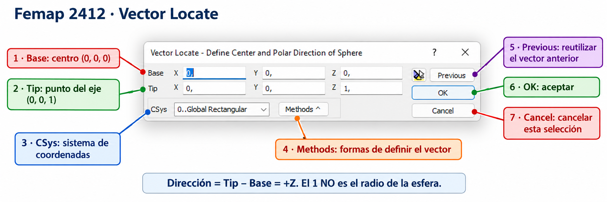

# Femap Student 2412: guía de trabajo en milímetros

**Menús en inglés · Geometría en mm · Fuerzas en N · Tensiones y presiones en MPa**

**Estado: guía en desarrollo, con rutas contrastadas con las capturas de clase.** Se han revisado las imágenes de `Geometry → Surface`, `Geometry → Midsurface`, `Model → Load`, `Model → Constraint`, `Mesh → Mesh Control`, `Mesh → Geometry` y `View Options`. Las rutas de la tabla siguiente sí se leen en esas imágenes. Los formularios posteriores, el comando de corte y los resultados todavía requieren comprobar sus propias ventanas. No se ha ejecutado Femap en el entorno de elaboración.

Las capturas se han podido leer en el chat, pero sus archivos originales no están disponibles en el repositorio. Por eso esta revisión incorpora sus rutas e instrucciones, sin sustituir las fotos por interfaces recreadas. La ilustración de Vector Locate ya existente se identifica expresamente como ilustración. Se supone Simcenter/NX Nastran; comprueba el solver y soluciones disponibles en clase.

## 0. Dónde pinchar: rutas verificadas en tus capturas

Pulsa primero el menú de la barra superior y después cada opción de la ruta. Los puntos suspensivos `…` indican que se abre un cuadro; un triángulo a la derecha indica otro submenú.

| Quiero… | Ruta que aparece en tus capturas | Atajo visible |
|---|---|---|
| Crear un punto geométrico | **Geometry → Point…** | — |
| Crear líneas | **Geometry → Curve - Line → …**; falta ver ese submenú | — |
| Crear superficie por esquinas | **Geometry → Surface → Corners…** | — |
| Crear superficie por bordes | **Geometry → Surface → Edge Curves…** | **Shift + F9** |
| Crear superficie por extrusión | **Geometry → Surface → Extrude…** | — |
| Crear superficie por revolución | **Geometry → Surface → Revolve…** | — |
| Crear una superficie plana | **Geometry → Surface → Plane…** | — |
| Crear una superficie cilíndrica | **Geometry → Surface → Cylinder…** | — |
| Crear una superficie esférica | **Geometry → Surface → Sphere…** | — |
| Crear/editar material | **Model → Material…** | — |
| Crear/editar propiedad y espesor | **Model → Property…** | — |
| Gestionar conjuntos de cargas | **Model → Load → Create/Manage Set…** | **Ctrl + F2** |
| Aplicar carga sobre punto geométrico | **Model → Load → On Point…** | — |
| Aplicar carga sobre curva | **Model → Load → On Curve…** | — |
| Aplicar carga sobre superficie | **Model → Load → On Surface…** | — |
| Gestionar conjuntos de apoyos | **Model → Constraint → Create/Manage Set…** | **Shift + F2** |
| Apoyar un punto geométrico | **Model → Constraint → On Point…** | — |
| Apoyar un borde geométrico | **Model → Constraint → On Curve…** | — |
| Restringir una superficie | **Model → Constraint → On Surface…** | — |
| Abrir la definición del análisis | **Model → Analysis…** | — |
| Definir tamaño general de malla | **Mesh → Mesh Control → Default Size…** | — |
| Definir divisiones/tamaño en una curva | **Mesh → Mesh Control → Size Along Curve…** | **Shift + F10** |
| Definir tamaño en una superficie | **Mesh → Mesh Control → Size On Surface…** | — |
| Generar malla sobre una superficie | **Mesh → Geometry → Surface…** | **Shift + F11** |
| Acceder al remallado | **Mesh → Remesh → …**; falta ver ese submenú | — |

**Tamaño y generación son dos operaciones distintas:** `Mesh Control → Size On Surface…` fija el tamaño; `Mesh → Geometry → Surface…` crea nodos y elementos. En las capturas repetidas, el submenú con `Point…`, `Curve…`, `Surface…` y `Solids…` corresponde a las operaciones de mallado de geometría, aunque el resaltado amarillo haya quedado sobre otra fila al capturar.

### Lo que significa que una opción esté gris

En tus capturas, `Model → Load → Nodal… / Elemental…` y `Model → Constraint → Nodal…` aparecen deshabilitados, mientras que las opciones sobre geometría están disponibles. Es compatible con un modelo que todavía no tiene nodos/elementos utilizables o con el estado actual de sus conjuntos. Comprueba malla y conjunto activo; la imagen sola no permite atribuirlo a una única causa.

Si quieres aplicar apoyos antes de mallar, utiliza **On Curve…** sobre los bordes geométricos. Si quieres aplicarlos directamente a nodos, genera primero la malla, comprueba el conjunto y utiliza **Nodal…** cuando esté habilitado. Un punto geométrico y un nodo no son la misma entidad.

### La ventana View Options de tu primera captura

Esa ventana configura **cómo se muestran** las entidades. No crea materiales, cargas, apoyos ni cortes geométricos.

1. Selecciona la categoría de la izquierda: **Labels, Entities and Color**, **Tools and View Style** o **PostProcessing**.
2. En **Options**, selecciona la entidad/función que quieras ajustar: por ejemplo, `Surface`, `Node`, `Element`, `Element - Shell` o `Load Vectors`.
3. Cambia sus opciones a la derecha. Los controles disponibles dependen de la fila seleccionada.
4. **Apply** aplica los cambios sin cerrar; **OK** los acepta y cierra; **Cancel** cierra sin aceptar cambios pendientes, pero no necesariamente deshace lo ya aplicado con Apply.

En la captura está seleccionado **Label Parameters**. Se ven fuente, tamaño, color de vista y profundidad de texto: son ajustes de etiquetas. Para estudiar opciones de resultados, selecciona **PostProcessing**; eso no sustituye a elegir el caso y vector calculado.

### Midsurface y el corte de tu esfera

La captura de **Geometry → Midsurface** muestra `Single in Solid…`, `Single…`, `Trim to Solid…`, `Trim with Curve…`, etc. Son herramientas del flujo de superficies medias. El nombre `Trim` por sí solo no demuestra que sea la operación apropiada para cortar tu esfera con un plano. La captura de **Geometry → Surface** muestra `Plane…`, pero **crear un plano tampoco ejecuta por sí solo el corte**. Hace falta ver **Geometry → Solid** para identificar las opciones de corte disponibles y después comprobar qué entidades admite el comando.

## 1. Preparar las unidades

Usaremos **N–mm–s**: longitud en mm, fuerza en N y presión/tensión en **MPa = N/mm²**. La unidad coherente de masa es la tonelada.

| Dato | Valor de entrada | Unidad |
|---|---:|---|
| Lado de placa de práctica | 1000 | mm |
| Espesor de placa | 10 | mm |
| Young del acero de ejemplo | 210000 | MPa |
| Poisson | 0.3 | Sin unidades |
| Densidad de masa del acero | 7.85e-9 | t/mm³ |
| Gravedad | 9810 | mm/s² |
| Presión de práctica | 0.01 | MPa |
| Radio medio del cilindro | 500 | mm |
| Longitud del cilindro | 1000 | mm |
| Espesor del cilindro y conos | 5 | mm |

**No mezcles `E = 2.1e11` o `densidad = 7850` con estas longitudes en mm.** Esos valores pertenecen al sistema m–N–kg–s de la guía retirada. Cambiar el nombre del modelo no convierte sus datos. Si ya tienes un modelo en metros, debes convertir coherentemente geometría, espesores, materiales y cargas, no sólo escalar el dibujo.

Tu captura muestra valores como `0,` y `1,`. Femap puede mostrar el separador decimal de la configuración regional. Los ejemplos con punto indican el valor numérico: utiliza el separador que acepte tu instalación y comprueba el valor al salir de la casilla. Para coordenadas enteras puedes escribir `0`, `1`, `500` o `1000`.

## 2. El cuadro que has enviado: Vector Locate

El título es **`Vector Locate - Define Center and Polar Direction of Sphere`**: en esa operación se definen el **centro** y la **dirección polar de una esfera**. El cuadro no está pidiendo su radio.

*Ilustración explicativa generada a partir de tu captura y revisada en sus campos y valores. No es una captura literal nueva del programa; utiliza la imagen original como referencia para la disposición exacta de la interfaz. No se utiliza como prueba de las ventanas de otros comandos.*

### 2.1. Qué significa cada control

| Control | Qué representa | Qué hacer en el ejemplo |
|---|---|---|
| **1. Base — X, Y, Z** | Punto inicial del vector; en esta operación, centro de la esfera | Introducir `0`, `0`, `0` |
| **2. Tip — X, Y, Z** | Segundo punto que marca la dirección | Introducir `0`, `0`, `1` para apuntar a +Z |
| **3. CSys** | Sistema en el que se expresan esas coordenadas | Mantener `0..Global Rectangular` |
| **4. Methods** | Métodos alternativos para definir el vector | Usar Base/Tip para este ejemplo; las opciones concretas se explicarán con el menú desplegado |
| **5. Previous** | Reutiliza la definición anterior del vector | Sólo si corresponde al eje que quieres; no es Deshacer |
| **6. OK** | Acepta esta definición | Pulsar después de revisar datos y sistema |
| **7. Cancel** | Cancela este cuadro/paso | No equivale a borrar el modelo |
| **? del título** | Ayuda contextual, cuando está habilitada | Consultar la descripción del cuadro |
| **Icono a la izquierda de Previous** | Su función exacta no se puede confirmar sólo con esta captura | Consultar su tooltip/ayuda; no es necesario para introducir Base y Tip numéricamente |

### 2.2. Tip es un punto, no un radio

En el sistema rectangular de la captura:

$$
\mathbf d=\mathrm{Tip}-\mathrm{Base}.
$$

Base `(0,0,0)` y Tip `(0,0,1)` definen dirección **+Z**. El `1` identifica un punto del eje, **no obliga a que la esfera tenga radio 1 mm**. El radio se introduce cuando otra ventana lo pida explícitamente.

Si el comando necesita sólo orientación, Tip `(0,0,1)` y `(0,0,1000)` desde esa misma Base dan la misma dirección. En otras operaciones que usen también longitud de vector, su magnitud sí puede importar. Lee el título: este cuadro concreto pide centro y dirección polar.

### 2.3. Un eje desplazado: ejemplo completo

Quieres un eje paralelo a Z que pase por `(500,0,0)`:

1. En **Base**, escribe X=`500`, Y=`0`, Z=`0`.
2. En **Tip**, escribe X=`500`, Y=`0`, Z=`1`.
3. Mantén **CSys = 0..Global Rectangular**.
4. Pulsa **OK**.

Si pusieras Tip `(0,0,1)`, el vector sería `(-500,0,1)` y quedaría inclinado. **Tip son las coordenadas del punto final, no las componentes del vector relativas a Base.** No hagas coincidir Base y Tip: obtendrías dirección nula.

| Dirección deseada | Base | Tip |
|---|---|---|
| +X | (0,0,0) | (1,0,0) |
| +Y | (0,0,0) | (0,1,0) |
| +Z | (0,0,0) | (0,0,1) |
| −Z | (0,0,0) | (0,0,−1) |
| +Z pasando por (500,200,0) | (500,200,0) | (500,200,1) |

### 2.4. CSys y los otros cuadros de selección

El **CSys de este cuadro** indica cómo interpretar las coordenadas del vector. Cambiarlo no asigna automáticamente sistemas cilíndricos de restricciones a los nodos ni transforma todos los resultados.

- **Selección de entidades:** pide puntos, curvas, superficies, nodos o elementos. Selecciona el tipo que solicita el título.
- **Introducción de coordenadas:** pide la posición de un punto respecto a un sistema y referencia.
- **Definición de vector:** pide una dirección/eje mediante puntos u otros métodos.
- **Introducción de dimensiones:** pide radio, espesor, longitud o ángulo. Introduce la dimensión cuando se solicite, no en el campo Tip de una ventana anterior.

Las opciones desplegadas de **Methods** dependen de la selección y operación. Se documentarán con el menú abierto; no se deducen de la captura actual.

## 3. Crear una placa triangular

**Datos en mm:** A `(0,0,0)`, B `(1000,0,0)`, C `(1000,1000,0)`. Son valores de práctica; no son medidas deducidas de tu fotografía.

**Rutas confirmadas:** `Geometry → Point…`, `Geometry → Curve - Line → …` y `Geometry → Surface → Edge Curves…` (**Shift + F9**). Falta ver el submenú de Curve - Line para indicar su opción concreta.

1. Crea los puntos A, B y C introduciendo sus coordenadas.
2. Crea las líneas A–B, B–C y C–A.
3. Activa la creación de superficie por contorno y selecciona esas tres curvas.
4. Acepta y comprueba que existe una **Surface**, no sólo tres líneas.
5. Comprueba que Z=`0` en todos los puntos.

Para un rectángulo, utiliza cuatro esquinas o cuatro curvas cerradas. Para un agujero, dibuja su contorno y recorta la superficie con la operación de **Trim**; dibujar un círculo encima no elimina material. Divide superficies en cambios de espesor o zonas de carga/refuerzo, comprobando su conexión.

**Capturas pendientes:** creación de puntos, extremos de línea y selección de curvas para la superficie.

## 4. Crear cilindros, conos y esfera

### 4.1. Cilindro: línea paralela al eje + revolución

**Ruta confirmada:** `Geometry → Surface → Revolve…`. También existe el comando directo `Geometry → Surface → Cylinder…`; su cuadro de parámetros aún no se ha mostrado. El procedimiento siguiente utiliza la revolución de una generatriz.

1. Crea P1 `(500,0,0)` y P2 `(500,0,1000)`.
2. Únelos con una línea: la **generatriz**.
3. Activa superficie por revolución y selecciona la línea.
4. Cuando pida el eje, usa Base `(0,0,0)` y Tip `(0,0,1)` en el sistema global rectangular.
5. Cuando pida el ángulo, introduce `360°`.
6. Comprueba radio medio 500 mm y longitud 1000 mm.

No pongas Base sobre la generatriz si quieres girar alrededor del Z global. La revolución produce la pared lateral; las tapas son superficies adicionales. Como alternativa puedes extruir una circunferencia como superficie a lo largo del eje.

### 4.2. Tronco de cono: línea inclinada + revolución

1. Crea P1 `(500,0,0)` y P2 `(250,0,1000)`.
2. Crea la línea entre ambos.
3. Revoluciónala alrededor de Base `(0,0,0)` y Tip `(0,0,1)`.
4. Introduce `360°` cuando se pida el ángulo.
5. Comprueba radios medios 500/250 mm y altura 1000 mm.

Para un cono completo, P2 es `(0,0,1000)`. La punta concentra las generatrices y exige atención al mallado. El espesor shell se mide normal a la pared, no radialmente. Estas dimensiones son de la superficie media.

### 4.3. Esfera: cómo continuar desde tu ventana

**Dónde pinchar, confirmado:** `Geometry → Surface → Sphere…`. El cuadro Vector Locate del apartado 2 pide el centro y la dirección polar.

1. Define Base como centro, por ejemplo `(0,0,0)`.
2. Define Tip para orientar el eje polar, por ejemplo `(0,0,1)`.
3. Comprueba CSys y pulsa **OK**.
4. En el paso que pida radio, introduce, por ejemplo, `500 mm`.
5. Si pide límites angulares, elige los de la esfera completa o casquete deseado. Las casillas y convenciones se explicarán con la captura de ese paso.

Una superficie esférica shell no es un sólido macizo. Comprueba qué tipo de entidad crea la operación.

**Menú de revolución/esfera recibido. Cuadros pendientes:** selección de generatriz, eje/ángulo y ventana de radio/límites de esfera. La imagen del apartado 2 corresponde a esfera y no sustituye a una captura del comando Revolve.

### 4.4. Cortar una esfera con un plano

**Objetivo:** dividir geométricamente la esfera, o recortarla para conservar una semiesfera/casquete. Un plano de recorte de la **vista** sólo oculta parte del dibujo y no sirve para cambiar la geometría que vas a mallar.

Primero distingue tres operaciones:

- **Intersección:** obtiene la curva donde plano y esfera se cruzan; no necesariamente divide la esfera.
- **División / Slice:** separa la geometría en regiones; normalmente puedes conservar ambos lados.
- **Recorte / Trim:** elimina la región que no quieres conservar, según las opciones de la herramienta.

La ruta exacta de corte de Femap 2412 queda pendiente de ver el menú: depende de si has creado superficies, un cuerpo de superficies o un sólido. Busca la operación de división/recorte mediante plano adecuada al tipo de entidad; no se presupone que un comando que pida sólidos acepte una superficie aislada.

#### Ejemplo A: obtener una semiesfera

Supongamos centro `(0,0,0)` y radio `500 mm`.

1. Guarda una copia del modelo antes del corte.
2. Activa la operación de **corte geométrico mediante plano** y selecciona la esfera o las superficies que la componen, según lo que solicite el cuadro.
3. Define el plano **XY por el centro**, es decir, **Z = 0**.
4. Si el cuadro pide **un punto del plano y su normal**, utiliza punto `(0,0,0)` y dirección normal `(0,0,1)` en coordenadas globales.
5. **Sólo si ese paso pide la normal mediante Base/Tip**, introduce Base `(0,0,0)` y Tip `(0,0,1)`. Lee el título: un cuadro que pida otra dirección no se rellena automáticamente igual.
6. Si puedes elegir, conserva inicialmente ambos lados para verificar el corte. Para quedarte con la semiesfera superior, conserva la región **Z ≥ 0**; para la inferior, **Z ≤ 0**. Usa la previsualización o selecciona un punto claramente situado en el lado deseado; no deduzcas el lado conservado sólo del signo de la normal.
7. Acepta y comprueba que el borde resultante es una circunferencia de radio **500 mm** situada en Z=0.
8. Si hiciste sólo una división, elimina después únicamente la región que no necesites. Si quieres conservar dos regiones, no borres ninguna.

La **normal es perpendicular al plano**: para un plano horizontal XY, apunta a Z. No es una dirección contenida en el plano.

#### Ejemplo B: cortar a Z = 250 mm para crear un casquete

Para la misma esfera de radio 500 mm:

- Punto del plano: `(0,0,250)`.
- Normal: `(0,0,1)`.
- Si se introduce mediante Base/Tip: **Base `(0,0,250)` y Tip `(0,0,251)`**.
- Para conservar el casquete superior, mantén la región **Z ≥ 250**.

El radio de la circunferencia del corte será:

$$
r_{corte}=\sqrt{R^2-d^2}=\sqrt{500^2-250^2}\approx433.013\ \mathrm{mm}.
$$

Aquí d es la distancia del centro al plano. El casquete superior tiene altura `500 − 250 = 250 mm`. Si el centro no está en el origen, mide la distancia respecto al centro real, no respecto a Z=0.

#### Si el cuadro pide tres puntos del plano

Para Z=250 puedes usar:

- P1 `(0,0,250)`.
- P2 `(1000,0,250)`.
- P3 `(0,1000,250)`.

Deben ser tres puntos **no alineados**. Para Z=0, cambia las tres coordenadas Z a cero. El orden puede invertir la normal y el lado positivo, pero no cambia el plano geométrico. No confundas estos tres puntos con Base/Tip de una normal.

| Plano que pasa por el origen | Normal global |
|---|---|
| XY: Z=0 | (0,0,1) |
| YZ: X=0 | (1,0,0) |
| XZ: Y=0 | (0,1,0) |

#### Comprobaciones y pasos posteriores

- Si la distancia del centro al plano es mayor que el radio, no hay intersección. Si es igual, el plano es tangente y no produce una circunferencia de corte de radio positivo.
- Dibujar un plano encima de la esfera no la corta por sí solo: ejecuta la operación geométrica correspondiente.
- Si la herramienta exige una **superficie cortante finita**, ésta debe cubrir toda la sección; no necesita esa extensión si el comando utiliza un plano matemático infinito.
- En una lámina, cortar deja un borde. No aparece necesariamente una tapa de chapa: créala y conéctala sólo si existe en el problema. Un corte de sólido puede generar una cara plana de cierre; no es el mismo modelo físico.
- Si ya había malla, comprueba qué ocurre con los elementos anteriores. Cortar geometría no garantiza que se eliminen o adapten todos los elementos. Remalla las superficies conservadas y revisa apoyos/cargas y conexiones.
- Si el corte representa un **borde físico**, aplica las condiciones reales de ese borde. Si sólo modelas media esfera por **simetría** y geometría/cargas/apoyos lo permiten, aplica condiciones de simetría. Para shells en Z=0 y ejes globales, son TZ=0, RX=0 y RY=0; no equivalen a un borde libre ni a un empotramiento.

**Capturas pendientes:** menú de corte, selección de entidad, definición del plano y elección del lado conservado. La captura de creación de esfera del apartado 2 no demuestra cuál es el cuadro de corte.

## 5. Material y espesor

**Dónde pinchar, confirmado:** `Model → Material…` y `Model → Property…`. Las capturas muestran las entradas de menú; faltan los formularios abiertos para marcar sus casillas.

### Material

1. Crea un material llamado `Acero_N_mm_MPa`.
2. Selecciona **Isotropic**.
3. Introduce Young=`210000`, Poisson=`0.3`, densidad de masa=`7.85e-9`.
4. Acepta. Utiliza los datos del enunciado si son diferentes.

### Propiedad

1. Crea una propiedad **Plate/Shell**, apta para membrana y flexión.
2. Asigna el material anterior.
3. Introduce espesor `10` para la placa o `5` para cilindro/conos.
4. Comienza con superficie media y offset nulo.
5. Al mallar, selecciona esta propiedad; comprueba después su ID en un elemento.

Cambiar el espesor no exige remallar si no cambia la superficie media, pero **sí volver a resolver**. Una propiedad de membrana pura no sirve para estudiar flexión. La densidad importa para peso propio, inercia y modos.

**Capturas pendientes:** formulario de material isotrópico y propiedad Plate/Shell.

## 6. Crear y modificar el mallado

**Dónde pinchar, confirmado:** `Mesh → Mesh Control → Size On Surface…`; para curvas, `Mesh → Mesh Control → Size Along Curve…` (**Shift + F10**). Después genera la malla con `Mesh → Geometry → Surface…` (**Shift + F11**).

### Primera malla

1. Fija tamaño `100 mm` para la placa de 1000 mm.
2. Ajusta divisiones en curvas cuando quieras controlar un borde.
3. Selecciona superficie y propiedad de espesor 10 mm.
4. Genera la malla, preferentemente con cuadriláteros de buena calidad, admitiendo triángulos donde convenga.
5. Revisa calidad, normales, nodos coincidentes y bordes libres.

### Remallar y refinar

1. Guarda una copia y anota carga total y apoyos.
2. Cambia el tamaño a `50 mm`.
3. Sustituye la malla con la operación de remallado disponible. Si debes borrarla, elimina sólo elementos de esa zona y nodos realmente huérfanos; conserva geometría y nodos compartidos.
4. Remalla y comprueba las conexiones con zonas vecinas.
5. Revisa cargas y apoyos: los asignados a nodos/elementos eliminados pueden perderse; verifica también los asociados a geometría.
6. Resuelve y compara. Si hace falta y la licencia permite el tamaño, repite con `25 mm`.

Una malla mapeada de cuatro lados necesita divisiones compatibles en lados opuestos. Para un triángulo puedes usar malla libre o dividirlo en regiones. Evita cuadriláteros muy torcidos sólo para que todos tengan cuatro lados.

En el cilindro de radio 500 y longitud 1000 mm, 48 divisiones circunferenciales y 16 longitudinales producen lados aproximados 65/62.5 mm. Verifica que la costura de 0°/360° comparte nodos; dos filas coincidentes sin conexión se comportan como una abertura. En conos, comprueba el estrechamiento de elementos hacia el radio menor.

**Calidad:** revisa distorsión, relación de aspecto, alabeo y Jacobiano según el elemento. Fusiona nodos sólo con tolerancia pequeña respecto a las separaciones físicas; no cierres holguras reales. No crees nodos colgantes al refinar una zona.

**Convergencia:** compara la flecha y esfuerzos en los mismos puntos/secciones físicos. Un pico singular en una fuerza puntual o extremo de apoyo ideal puede crecer al refinar. No uses únicamente el máximo suavizado para decidir.

**Menús de tamaño y generación de malla recibidos. Cuadros pendientes:** tamaño de malla, propiedad/tipo de mallado, remallado y calidad.

## 7. Poner apoyos

**Dónde pinchar, confirmado:** primero `Model → Constraint → Create/Manage Set…` (**Shift + F2**). Para un borde geométrico, `Model → Constraint → On Curve…`; para puntos, `On Point…`; para superficies, `On Surface…`. `Nodal…` aparece en gris en tu captura: revisa que haya nodos y un conjunto utilizable antes de aplicarlo a la malla.

1. Crea un **Constraint Set**.
2. Selecciona las entidades de apoyo.
3. Marca las componentes que quieres **impedir**.
4. Revisa símbolos y sistema de coordenadas.
5. Asigna ese conjunto al subcaso de análisis.

Para placa XY, Z es perpendicular. TX/TY/TZ son traslaciones; RX/RY/RZ son giros.

| Apoyo | Componentes típicas | Precaución |
|---|---|---|
| Empotramiento de borde shell | TX, TY, TZ, RX, RY, RZ | Representa una unión rígida a la base |
| Borde simplemente apoyado en flexión XY | TZ; giros de flexión libres | Añadir mínimas restricciones en el plano |
| Articulación puntual 3D | TX, TY, TZ; giros libres | Puede dejar mecanismos globales |
| Rodillo | Sólo traslación normal al plano de apoyo | Permite deslizamiento tangencial |
| Borde libre | Ninguna restricción directa | Debe seguir conectado a la estructura |
| Apoyo elástico | Muelle con rigidez finita | N/mm en traslación; N·mm/rad en giro |
| Contacto/holgura | Formulación unilateral adecuada | Puede requerir solución no lineal |

### Placa simplemente apoyada sin flotar en su plano

Para A `(0,0,0)` y B `(1000,0,0)`:

1. Impide TZ en los bordes simplemente apoyados.
2. En A impide además TX y TY.
3. En B impide además TY.
4. Mantén libres los giros de flexión.

Este esquema corresponde al ejemplo lineal de flexión. Con acciones de membrana, temperatura o apoyos físicos distintos, revisa las restricciones. No bloquees RZ en toda la placa sólo para ocultar avisos del solver. Un apoyo articulado puntual no es lo mismo que impedir las tres traslaciones de todos los nodos de un borde.

### Simetría shell en ejes globales

| Plano | Traslación impedida | Giros impedidos |
|---|---|---|
| X constante | TX | RY, RZ |
| Y constante | TY | RX, RZ |
| Z constante | TZ | RX, RY |

La geometría, materiales, cargas y apoyos deben admitir la simetría. Estas condiciones no son las de antisimetría y pueden excluir modos de pandeo no simétricos.

### Apoyos radiales y uniones

En un cilindro, el apoyo radial requiere direcciones nodales cilíndricas correctas. Bloquear X global en todos los nodos no impide el movimiento radial del anillo. Comprueba el sistema nodal de desplazamientos/restricciones —relacionado con CD de GRID en Nastran—; cambiar CSys en un cuadro de dibujo no basta. En un cono, radial no coincide con normal a la pared.

Una articulación interna de viga utiliza liberaciones de extremo adecuadas. RBE2 impone una unión rígida; RBE3 distribuye/interpola movimientos y cargas y no es un apoyo por sí mismo. Un muelle requiere rigidez, dirección y conectividad correctas a la estructura y su referencia.

**Menú de apoyos recibido. Cuadros pendientes:** conjunto, casillas TX–RZ, selección de entidades y sistema nodal; muelles/liberaciones si se utilizan.

## 8. Poner cargas

**Dónde pinchar, confirmado:** primero `Model → Load → Create/Manage Set…` (**Ctrl + F2**). Para una carga sobre la chapa, abre `Model → Load → On Surface…` y después selecciona el tipo de carga en el formulario. Para bordes, `On Curve…`; para puntos geométricos, `On Point…`. Las cargas `Nodal…` y `Elemental…` están en gris en la captura y requieren comprobar la malla/estado del modelo.

1. Crea un **Load Set**.
2. Selecciona las entidades.
3. Define magnitud, dirección y sistema.
4. Muestra las flechas y calcula la resultante esperada.
5. Asigna ese conjunto al subcaso.

| Tipo | Qué introducir/comprobar |
|---|---|
| Presión | MPa, por ejemplo `0.01`; sobre superficies/elementos shell |
| Fuerza nodal | Componentes en N; comprobar valor por nodo o total distribuido |
| Momento nodal | Componentes en N·mm; regla de la mano derecha |
| Carga de borde | Intensidad en N/mm o lo que solicite el formulario; no confundir con presión |
| Gravedad | Dirección y `9810 mm/s²`; densidad coherente |
| Hidrostática | Variación espacial de presión con la profundidad |
| Temperatura | Temperatura/referencia y coeficiente de expansión coherentes |
| Desplazamiento impuesto | Valor en mm y relación SPC/SPCD adecuada en Nastran |

### Presión en la placa

1. Selecciona **Pressure** sobre la superficie o elementos.
2. Introduce `0.01 MPa`.
3. Comprueba flechas: si debe cargar hacia abajo en XY, deben apuntar a −Z.
4. No memorices «positivo = hacia abajo»: depende de normales y definición de carga.
5. Para el triángulo de área 500000 mm², la resultante debe ser **5000 N**.

En un cilindro con presión interna, las flechas apuntan hacia fuera. Para una superficie curva, la resultante es la suma vectorial de presiones normales, no siempre presión por área curva en una sola dirección. Si el recipiente es cerrado, representa el efecto de las tapas; una pared abierta con presión lateral no produce automáticamente el esfuerzo axial de un recipiente cerrado.

### Fuerzas y cargas de borde

Una intensidad uniforme $q$ sobre una longitud $L$ da total $qL$ si mantiene dirección. Para una discretización lineal uniforme, cada tramo aporta $q\ell/2$ a cada extremo. No confundas 100 N en **cada nodo** con 100 N totales: al refinar, la primera opción cambia la carga.

Para elementos de mayor orden, usa la distribución consistente correspondiente. Una fuerza puntual puede originar un pico singular; una carga distribuida sobre la superficie física de contacto suele representarla mejor.

### Hidrostática, gravedad y temperatura

Agua dulce en N–mm–s: densidad `1e-9 t/mm³`, gravedad `9810 mm/s²`. A 1000 mm bajo el nivel libre, presión `0.00981 MPa`. Define la variación espacial mediante las opciones compatibles; una función temporal no es una variación espacial. En un panel vertical rectangular con borde superior en el nivel libre, la resultante es $\rho g bH^2/2$ y está a $2H/3$ bajo ese nivel.

Para peso propio, utiliza densidad y gravedad; no añadas también fuerzas de ese mismo peso. Para temperatura, una pieza libre se dilata y los apoyos pueden generar esfuerzos. Un gradiente por espesor que cause flexión requiere la definición térmica shell adecuada, no una temperatura uniforme.

Crea casos separados y combina cargas o resultados compatibles con los coeficientes correctos. No sumes máximos que aparecen en puntos diferentes ni sumes directamente von Mises de casos distintos.

**Menú de cargas recibido. Cuadros pendientes:** conjunto, presión, fuerzas/momentos, carga de borde, gravedad, funciones espaciales y temperatura.

## 9. Analizar

**Dónde pinchar, confirmado:** `Model → Analysis…`. Falta la captura del gestor abierto para indicar sus botones y campos exactos.

1. Crea el conjunto para el solver instalado.
2. Selecciona estática lineal, normalmente **SOL 101** en Nastran.
3. Asigna explícitamente **Constraint Set** y **Load Set** al subcaso.
4. Solicita desplazamientos, reacciones **SPC forces**, tensiones y **fuerzas/momentos de elementos shell**.
5. Para cortes, solicita las salidas de fuerzas nodales de elemento/balance que necesite la herramienta.
6. Ejecuta **Analyze**.
7. Revisa registro y `.f06`: finalización, singularidades y restricciones automáticas **AUTOSPC**.
8. Abre los resultados del trabajo recién calculado.

Un modelo puede mostrar colores aunque esté mal definido. Una singularidad puede indicar movimiento rígido o falta de conexión; no añadas empotramientos arbitrarios para silenciarla. Un fichero de resultados no demuestra que la solución sea válida.

Para frecuencias usa modal; para pandeo, la solución con precarga apropiada; para gran deformación, plasticidad o contacto, una solución no lineal compatible. Que la tensión sea inferior al límite elástico no descarta pandeo de chapas/cilindros/conos. Si la flecha es comparable al espesor, revisa la validez geométrica del análisis lineal.

**Capturas pendientes:** tipo de análisis, conjuntos, solicitud de salidas y monitor.

## 10. Ver flechas y esfuerzos máximos

**Rutas orientativas:** `View → Select`, controles **Deformed / Contour**, **Output Set** y **Data Table** o listado de resultados.

1. Selecciona el **Output Set** recién calculado.
2. Muestra deformada con forma original; comprueba la escala amplificada.
3. En placa XY, mira desplazamiento Z además del total.
4. Comprueba reacciones y equilibrio.
5. Selecciona la magnitud shell y comprueba ejes/unidades.
6. Envía sus valores a la tabla, ordena y localiza máximo **y mínimo**.
7. Selecciona el ID extremo para localizarlo en el modelo.
8. Registra caso, componente, cara, posición de evaluación y promediado.

| Magnitud shell | Significado | Unidades |
|---|---|---|
| $N_x,N_y$ | Fuerzas normales de membrana | N/mm |
| $N_{xy}$ | Cortante de membrana dentro de la superficie | N/mm |
| $M_x,M_y$ | Momentos flectores por unidad de longitud | N·mm/mm |
| $M_{xy}$ | Momento torsor de placa por unidad de longitud | N·mm/mm |
| $Q_x,Q_y$ | Cortantes transversales | N/mm |
| Tensiones | Componentes/principales/von Mises; Top/Bottom | MPa |

**No confundas N/mm con N ni N·mm/mm con N·mm.** En vigas, las fuerzas son resultantes en N y los momentos en N·mm. Un momento de placa uniforme de 200 N·mm/mm sobre un corte apropiado de 500 mm integra 100000 N·mm; si varía o cambian los ejes, hay que integrar y transformar.

### Ejes, caras y suavizado

- Los ejes locales pueden cambiar entre elementos. En cilindros distingue circunferencial/longitudinal; en conos, circunferencial/meridional.
- Confirma la transformación de componentes antes de comparar o promediar.
- **Top/Bottom** dependen de la normal; revisa ambas caras.
- Compara contornos promediados con resultados elementales sin promediar. No suavices indiscriminadamente entre distintos materiales/espesores.
- Un mínimo negativo puede tener mayor valor absoluto que el máximo positivo.
- Identifica si los datos son de centro, esquina u otra posición; no mezcles al comparar mallas.

Para placa homogénea isotrópica, sin offset y con distribución lineal, en ejes/signos compatibles:

$$
\sigma_x^{\pm}=\frac{N_x}{t}\pm\frac{6M_x}{t^2}.
$$

Comprueba qué signo corresponde a Top/Bottom en el resultado concreto. Q/t no es automáticamente la tensión cortante máxima real a través del espesor.

### Cortes y equilibrio

Con **Freebody / Section Cut**, define corte, lado, ejes y punto de referencia. Integra fuerzas y momentos en un sistema común, incluyendo $\mathbf r\times\mathbf F$. No sumes ambos lados del corte: sus acciones internas se cancelan. No sumes directamente valores en N/mm para obtener N.

En estática, cargas y reacciones deben equilibrar fuerzas **y momentos**. Transforma primero resultados expresados en distintos sistemas nodales. Para la placa con 5000 N hacia −Z, la suma de reacciones debe ser aproximadamente +5000 N en Z. Incluye todas las acciones relevantes de apoyos/uniones/contactos.

**Capturas pendientes:** selección de resultados, deformada/contorno, tabla de extremos y herramienta de corte.

## 11. Valores de referencia

Valores analíticos, no resultados ejecutados en Femap:

| Ejercicio | Datos | Referencia |
|---|---|---|
| Triángulo bajo presión | Base/altura 1000 mm; p=0.01 MPa | Fuerza total 5000 N |
| Rectángulo a tracción | L=1000, b=500, t=10 mm; P=10000 N; E=210000 MPa | Nx=20 N/mm; tensión=2 MPa; alargamiento≈0.009524 mm |
| Cuadrado simplemente apoyado | a=1000, t=10 mm; E=210000 MPa; ν=0.3; p=0.001 MPa | Flecha central clásica≈0.2112 mm; carga total 1000 N |
| Cilindro delgado, lejos de extremos | R=500, t=5 mm; p interna=0.1 MPa | N circunferencial=50 N/mm; tensión circunferencial=10 MPa |
| Mismo cilindro cerrado con efecto de tapas | Datos anteriores | N axial=25 N/mm; tensión axial=5 MPa |

En tracción, permite contracción de Poisson y evita flexión parásita. En el cuadrado, la fórmula corresponde a cuatro bordes simplemente apoyados y presión uniforme; no sirve para el triángulo ni para bordes empotrados. En el cilindro, compara lejos de las perturbaciones de extremos/apoyos; alarga el modelo si no existe zona de membrana.

Antes de aceptar resultados, revisa: unidades, material/espesor, conectividad, apoyos, carga total, conjuntos del subcaso, deformada, equilibrio, extremos y convergencia.

## 12. Qué está comprobado y qué falta

- **Recibido y leído:** menús Surface, Midsurface, Load, Constraint, Mesh Control y Mesh Geometry; ventana View Options; cuadro Vector Locate de esfera.
- **Corregido:** el comando de control de curva se llama `Size Along Curve…`; la entrada de creación de líneas es `Curve - Line`; tamaños y generación de malla se explican por separado.
- **Pendiente para el corte que se está haciendo en clase:** submenú **Geometry → Solid** y ventana del comando de corte elegido. No hace falta repetir las capturas de Mesh.
- **Pendiente para señalar las casillas de entrada:** formularios abiertos de material, propiedad, malla, restricciones, cargas, análisis y resultados, según la ficha.
- **Pendiente para incrustar fotos originales en GitHub/PDF:** disponer de los PNG/JPG como archivos descargables, por ejemplo juntos en un ZIP. Las imágenes del chat se han utilizado para verificar rutas, pero no se han convertido en recreaciones de interfaz ni se afirma que estén ya incrustadas.

La ilustración de Vector Locate está identificada como ilustración. Para completar sus métodos alternativos aún falta `Methods` desplegado. La guía y el PDF son provisionales hasta completar las capturas y el corte geométrico.
